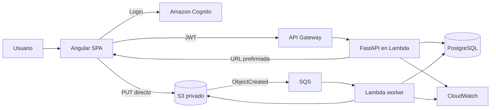

# AGENTS.md — Cloud Document Manager (CDM)

> Documento rector del producto y de las reglas de ingeniería. Léelo completo antes de proponer cambios o escribir código. Aplica a agentes de programación, asistentes de IA y colaboradores humanos.

## 1. Qué estamos construyendo

**Cloud Document Manager (CDM)** es una aplicación web SaaS para que equipos y organizaciones almacenen, organicen y consulten documentos en la nube de forma segura. El producto debe permitir que múltiples organizaciones —llamadas *workspaces*— utilicen la misma plataforma sin que una organización pueda acceder a los datos, archivos o metadatos de otra.

El MVP debe demostrar un flujo funcional de extremo a extremo:

1. Una persona se registra o inicia sesión.
2. Crea un workspace o acepta una invitación y accede a él.
3. Sube un documento desde el navegador directamente a Amazon S3 mediante una URL prefirmada.
4. La aplicación confirma la carga y guarda los metadatos en PostgreSQL.
5. Un proceso asíncrono recibe el evento del archivo mediante SQS y lo procesa con AWS Lambda.
6. El usuario consulta el catálogo, detalle y estado del documento.
7. Un usuario autorizado descarga el documento mediante una URL temporal.
8. Un usuario autorizado elimina lógicamente un documento; la eliminación física se realiza de forma controlada.

**Objetivo de ingeniería:** construir un proyecto de portafolio realista que demuestre backend Python, frontend Angular, arquitectura hexagonal, multi-tenancy, AWS, infraestructura como código, automatización, seguridad y pruebas. No es un tutorial de CRUD ni una demo desechable: debe tener fundamentos mantenibles y decisiones arquitectónicas justificadas, sin sobreingeniería.

## 2. Principios y prioridades

Orden de prioridad cuando existan conflictos:

1. Aislamiento y seguridad de datos entre workspaces.
2. Integridad de los documentos y consistencia entre PostgreSQL y S3.
3. Código sencillo, legible, probado y mantenible.
4. Experiencia de usuario clara y accesible.
5. Coste operativo bajo y recursos AWS controlados.
6. Escalabilidad razonable para un MVP, sin anticipar problemas hipotéticos.

Reglas no negociables:

- No escribir código espagueti ni concentrar lógica de negocio en controladores, routers, componentes Angular o modelos ORM.
- Aplicar arquitectura hexagonal / puertos y adaptadores. Las dependencias apuntan hacia el dominio y los casos de uso, nunca al revés.
- Mantener separación entre dominio, aplicación, adaptadores e infraestructura.
- No duplicar lógica. Extraer abstracciones solo cuando exista una necesidad real y demostrable.
- No implementar microservicios, event sourcing, CQRS completo ni patrones complejos sin una justificación concreta registrada en un ADR.
- No inventar requisitos. Ante una decisión de producto no especificada, documentar la suposición y proponer una decisión pequeña y reversible.
- No marcar una tarea como terminada si no se implementó, probó y verificó.
- No desplegar, destruir ni crear recursos AWS con coste sin revisar primero el plan, el coste estimado y la aprobación explícita del propietario.

## 3. Usuarios, workspaces y permisos

### 3.1 Conceptos

- **Usuario:** identidad autenticada mediante Amazon Cognito.
- **Workspace:** organización o espacio de trabajo que representa el tenant de la aplicación.
- **Membership:** relación de un usuario con un workspace y su rol.
- **Documento:** metadatos persistidos en PostgreSQL y contenido binario privado almacenado en S3.

Un usuario puede pertenecer a varios workspaces. El usuario debe poder seleccionar el workspace activo, pero esa selección del cliente nunca constituye prueba de autorización.

### 3.2 Roles iniciales propuestos

Usar como base estos roles, documentando cualquier cambio en un ADR:

- `OWNER`: control completo del workspace y sus miembros.
- `ADMIN`: administra miembros y documentos del workspace.
- `MEMBER`: puede consultar, subir y descargar documentos del workspace.

Reglas iniciales sugeridas para el MVP:

- Toda operación sobre un documento exige una membership activa en el workspace dueño del documento.
- `OWNER` y `ADMIN` pueden administrar miembros y eliminar documentos.
- `MEMBER` puede subir, listar, consultar y descargar documentos.
- El acceso entre tenants debe denegarse aunque el usuario conozca o adivine un UUID, URL, `document_id` o `storage_key`.
- No confiar en `workspace_id`, `tenant_id`, rol, propietario o `storage_key` enviados por el frontend. Resolver el contexto desde la identidad autenticada y la membership persistida en el backend.

Si una operación necesita cambiar el workspace activo, el backend debe comprobar que el usuario pertenece a ese workspace. Mantener el tenant context explícito en los casos de uso y repositorios.

## 4. Alcance funcional del MVP

### Incluido

- Registro, inicio y cierre de sesión con Cognito.
- Creación y selección de workspaces.
- Membresías y roles básicos.
- Autorización multi-tenant en backend.
- Creación de sesiones/intenciones de carga y generación de URLs prefirmadas S3.
- Carga directa desde Angular a S3 con indicador de progreso y errores comprensibles.
- Confirmación de carga y verificación del objeto en S3.
- Persistencia y consulta de metadatos de documentos.
- Procesamiento asíncrono básico mediante S3 → SQS → Lambda.
- Estados de procesamiento visibles para el usuario.
- Catálogo con filtros y paginación.
- Detalle, descarga autorizada y eliminación lógica.
- Validación de formatos, tamaño y metadatos técnicos.
- Logs, métricas, trazabilidad y manejo de errores.
- Pruebas unitarias, integración, seguridad multi-tenant y E2E del flujo principal.
- Infraestructura reproducible con Terraform y CI con GitHub Actions.

### Fuera del MVP, salvo aprobación explícita

- Edición colaborativa en tiempo real.
- OCR avanzado, búsqueda semántica, RAG o clasificación mediante IA.
- Firma electrónica, workflows de aprobación y versionado documental avanzado.
- Facturación, suscripciones y pagos.
- Aplicaciones móviles nativas.
- Integraciones empresariales externas no definidas.
- Antivirus comercial o servicio externo de análisis de malware. Si se desea, proponerlo como fase posterior; nunca afirmar que los archivos están libres de malware sin implementar y validar un control real.

## 5. Stack tecnológico acordado

| Capa | Tecnología |
|---|---|
| Frontend | Angular + TypeScript |
| Backend | Python + FastAPI |
| Arquitectura | Hexagonal / Ports and Adapters |
| Validación backend | Pydantic |
| Persistencia | SQLAlchemy |
| Migraciones | Alembic |
| Base de datos | PostgreSQL |
| Identidad | Amazon Cognito |
| Archivos | Amazon S3 privado |
| API en AWS | API Gateway + AWS Lambda |
| Procesamiento asíncrono | S3 Events + SQS + Dead Letter Queue + Lambda |
| Observabilidad | Amazon CloudWatch |
| Infraestructura | Terraform |
| Entorno local | Docker Compose |
| CI/CD | GitHub Actions |

No fijar versiones arbitrarias ni mezclar gestores de paquetes. Al inicializar el repositorio, seleccionar versiones estables compatibles, fijarlas y documentarlas. Una opción razonable es Python 3.12+, `uv` para dependencias Python y `pnpm` para Angular, pero registrar la decisión y comprobar compatibilidad antes de adoptarlas.

## 6. Arquitectura de alto nivel



### Responsabilidades

- **Angular:** presentación, navegación, formularios, carga a S3, progreso, estado y consumo de API. No contiene reglas de autorización ni decisiones de negocio críticas.
- **API Gateway:** entrada HTTP, límites y configuración de API.
- **FastAPI:** adaptador HTTP y composición de dependencias. Debe validar JWT, resolver el contexto del usuario/workspace y ejecutar casos de uso.
- **Casos de uso:** orquestan operaciones de negocio, transacciones y puertos. No conocen FastAPI, Angular, boto3 ni SQLAlchemy.
- **Dominio:** entidades, value objects, reglas e invariantes sin dependencia de frameworks.
- **Adaptador PostgreSQL:** implementa repositorios mediante SQLAlchemy y mapea persistencia al dominio.
- **Adaptador S3:** genera URLs prefirmadas, verifica objetos, obtiene metadatos y gestiona borrado físico cuando proceda.
- **SQS + Lambda worker:** procesa eventos de forma asíncrona, idempotente y con reintentos controlados.
- **Terraform:** declara recursos, permisos, configuración y outputs reproducibles.

Para ejecutar FastAPI sobre Lambda puede usarse un adaptador ASGI compatible (por ejemplo, Mangum) si la evaluación técnica confirma que es apropiado. Registrar esta elección en un ADR. No introducir un servidor permanente o contenedor de larga vida sin una razón documentada.

## 7. Organización sugerida del repositorio

Mantener un monorepo simple y explícito. Ajustar nombres si el framework genera convenciones distintas, pero preservar los límites arquitectónicos.

```text
cloud-document-manager/
├── AGENTS.md
├── README.md
├── .gitignore
├── .editorconfig
├── .env.example
├── compose.yaml
├── apps/
│   ├── api/
│   │   ├── pyproject.toml
│   │   ├── alembic.ini
│   │   ├── migrations/
│   │   ├── src/cdm/
│   │   │   ├── domain/
│   │   │   ├── application/
│   │   │   │   ├── ports/
│   │   │   │   └── use_cases/
│   │   │   ├── adapters/
│   │   │   │   ├── inbound/http/
│   │   │   │   └── outbound/
│   │   │   ├── config/
│   │   │   └── bootstrap/
│   │   └── tests/
│   │       ├── unit/
│   │       ├── integration/
│   │       └── contract/
│   └── web/
│       ├── package.json
│       └── src/
├── infrastructure/
│   └── terraform/
│       ├── modules/
│       └── environments/
│           ├── dev/
│           └── prod/
├── docs/
│   ├── architecture/
│   ├── adr/
│   ├── runbooks/
│   └── api/
├── scripts/
└── .github/workflows/
```

No crear toda esta estructura vacía de golpe. Construirla por etapas y añadir carpetas cuando exista código que las necesite. Evitar módulos llamados `utils`, `common` o `helpers` como cajones de sastre.

## 8. Backend: reglas de diseño

### 8.1 Capas

- `domain`: entidades, value objects, enums, errores de dominio e invariantes. Sin imports de FastAPI, SQLAlchemy, boto3 ni Pydantic.
- `application`: casos de uso, contratos/puertos, DTOs de aplicación y políticas de autorización. Define qué necesita del exterior.
- `adapters/inbound/http`: routers, schemas HTTP, dependencias y traducción de errores HTTP. Debe ser delgado.
- `adapters/outbound`: implementaciones de persistencia, almacenamiento, Cognito/JWKS, colas y servicios externos.
- `bootstrap` / composición: construye e inyecta dependencias por entorno.

### 8.2 Reglas

- Los routers no consultan directamente la sesión SQLAlchemy ni ejecutan reglas de negocio.
- Los repositorios devuelven entidades/modelos de dominio, no objetos ORM filtrándose por toda la aplicación.
- Los casos de uso reciben dependencias mediante interfaces/Protocol o contratos equivalentes.
- Las transacciones deben tener límites claros y no permanecer abiertas durante una llamada a S3.
- Validar entradas en el borde, pero volver a comprobar permisos e invariantes en el caso de uso.
- Usar errores tipados y un mapeo centralizado a respuestas HTTP estables.
- Configuración por variables de entorno, validada al arrancar. No leer secretos directamente desde código.
- Añadir timeouts, manejo explícito de errores AWS y logs estructurados.
- Evitar llamadas de red dentro de constructores de entidades o métodos de dominio.

## 9. Frontend: reglas de diseño

- Angular con TypeScript estricto.
- Separar páginas/rutas, componentes de presentación, servicios de acceso a API, modelos y estado.
- No convertir componentes en controladores con cientos de líneas.
- Centralizar cliente HTTP, interceptores, manejo de errores y configuración de entorno.
- Mantener tokens y sesión usando los mecanismos recomendados por la integración oficial de Cognito; no guardar secretos en el navegador.
- Las comprobaciones visuales de rol mejoran UX, pero nunca reemplazan autorización backend.
- La carga S3 debe mostrar progreso, cancelación cuando sea posible, éxito y errores recuperables.
- Incluir estados vacíos, skeleton/loading, errores, confirmaciones destructivas y navegación accesible por teclado.
- Diseño responsive y accesible (contraste, labels, foco, mensajes de estado).

### Pantallas MVP

1. Registro / inicio de sesión.
2. Selector y creación de workspace.
3. Vista principal del workspace.
4. Catálogo documental con búsqueda/filtros/paginación.
5. Flujo de carga de uno o varios documentos con progreso.
6. Detalle del documento y estado de procesamiento.
7. Acciones autorizadas: descargar y eliminar.
8. Administración básica de miembros/roles para `OWNER` y `ADMIN`.

## 10. Modelo de datos inicial

Este modelo es una base de diseño; antes de migrarlo, analizar relaciones, constraints, índices e invariantes y registrar un ADR si se modifica significativamente.

### `users`

- `id` UUID, PK.
- `cognito_sub` string, único y obligatorio.
- `email` opcional o normalizado según la política del producto; no usarlo como identificador de autorización.
- `display_name` opcional.
- `created_at`, `updated_at`.

### `workspaces`

- `id` UUID, PK.
- `name`.
- `slug` único según la política global o por propietario que se defina.
- `created_by` FK a users.
- `created_at`, `updated_at`.

### `workspace_memberships`

- `id` UUID, PK.
- `workspace_id` FK.
- `user_id` FK.
- `role` (`OWNER`, `ADMIN`, `MEMBER`).
- `status` (por ejemplo `ACTIVE`, `INVITED`, `SUSPENDED`).
- `created_at`, `updated_at`.
- Constraint único en `(workspace_id, user_id)`.

### `documents`

- `id` UUID, PK.
- `workspace_id` FK, obligatorio e indexado.
- `uploaded_by` FK a users.
- `original_filename` (nombre mostrado, saneado).
- `storage_key` único, opaco y generado por servidor; nunca construirlo confiando en una ruta del cliente.
- `content_type` detectado/validado.
- `size_bytes`.
- `checksum_sha256` cuando se pueda validar de forma fiable.
- `status`.
- `technical_metadata` JSONB para datos no críticos y extensibles.
- `created_at`, `updated_at`, `deleted_at`.

### `upload_sessions` (si los casos de uso lo requieren)

- `id` UUID, PK.
- `workspace_id`, `user_id`.
- `document_id` o identificador provisional de carga.
- `storage_key` generado en servidor.
- `expected_size`, `expected_content_type`, `expected_checksum` opcionales.
- `status`, `expires_at`, `created_at`, `updated_at`.

Se puede añadir `audit_events` para registrar cambios relevantes de autorización y ciclo de vida, evitando guardar tokens, URLs prefirmadas o contenido sensible en logs.

### Estados de documento propuestos

`PENDING_UPLOAD` → `UPLOADED` → `PROCESSING` → `READY`.

Ramas de error: `FAILED`. Borrado lógico: `DELETED` mediante `deleted_at` y/o estado. Si se introduce borrado físico asíncrono, definir `DELETION_PENDING` y su recuperación.

Las transiciones deben validarse en el dominio/caso de uso. No permitir que un evento repetido haga retroceder un documento desde `READY` a `PROCESSING`.

## 11. API inicial sugerida

Usar prefijo `/api/v1`. Contratos exactos se definen en OpenAPI y se versionan. Endpoints orientativos:

- `GET /health` — health check sin revelar secretos ni configuración sensible.
- `GET /api/v1/me` — perfil y contexto disponible del usuario autenticado.
- `POST /api/v1/workspaces` — crear workspace.
- `GET /api/v1/workspaces` — listar workspaces accesibles.
- `GET /api/v1/workspaces/{workspace_id}/members` — listar miembros autorizado.
- `POST /api/v1/workspaces/{workspace_id}/members` — invitar/agregar miembro si el flujo de invitación ya está definido.
- `POST /api/v1/workspaces/{workspace_id}/upload-sessions` — iniciar carga y obtener URL prefirmada.
- `POST /api/v1/workspaces/{workspace_id}/documents/{document_id}/complete` — confirmar carga y validar objeto.
- `GET /api/v1/workspaces/{workspace_id}/documents` — listar catálogo con filtros y paginación.
- `GET /api/v1/workspaces/{workspace_id}/documents/{document_id}` — detalle.
- `POST /api/v1/workspaces/{workspace_id}/documents/{document_id}/download-url` — generar URL temporal tras autorizar.
- `DELETE /api/v1/workspaces/{workspace_id}/documents/{document_id}` — eliminar lógicamente.

Cada endpoint debe verificar identidad, membership y rol. No responder con detalles que permitan enumerar documentos de otros workspaces.

## 12. Flujo de carga y procesamiento de archivos

1. Angular solicita iniciar una sesión de carga a la API con nombre, tamaño y tipo declarado.
2. FastAPI autentica, verifica membership/rol, aplica límites y allowlist, crea el registro/sesión provisional y genera `storage_key` aleatorio.
3. La API devuelve URL prefirmada de vida corta y los headers exactos que el cliente debe usar.
4. Angular transmite el binario directamente a S3; el binario no atraviesa FastAPI.
5. Angular solicita completar la carga.
6. Backend ejecuta `HeadObject`/verificaciones necesarias: objeto presente, tamaño, key esperada y metadatos consistentes.
7. La base de datos cambia el estado de forma transaccional y segura.
8. Evento S3 llega a SQS. Lambda procesa de manera idempotente y actualiza metadatos/estado.
9. El frontend consulta estado o se actualiza mediante polling razonable. No introducir WebSockets sin necesidad.

### Seguridad de archivos

- Bucket privado, S3 Block Public Access activo y acceso mediante IAM mínimo.
- URLs prefirmadas con expiración corta y alcance a un único objeto/operación.
- `storage_key` opaco, único, generado por backend y asociado al tenant en DB.
- Nunca confiar únicamente en extensión o `Content-Type` declarado por navegador.
- Allowlist explícita de formatos permitidos y límite de tamaño configurable.
- Normalizar el nombre de archivo solo para presentación; no usarlo como ruta S3.
- Verificar la existencia y tamaño real del objeto al confirmar.
- Evitar overwrite accidental: claves únicas o condiciones de escritura apropiadas.
- Configurar CORS de S3 para los orígenes exactos de frontend requeridos, no `*` en producción.
- Cifrado en reposo y TLS en tránsito.
- No registrar URLs prefirmadas, tokens, contenido de archivos ni datos sensibles.
- Definir limpieza de cargas incompletas y objetos huérfanos sin borrar documentos válidos.

### Idempotencia y cola

- La entrega de eventos S3/SQS puede repetirse; tratar mensajes como al menos una vez.
- Identificar eventos por bucket/key/version/event o identificador equivalente; persistir control idempotente.
- No duplicar procesamiento ni metadatos ante reintentos.
- Configurar visibility timeout, número de reintentos, DLQ y alarmas de mensajes acumulados.
- Registrar causa y correlación del fallo sin exponer datos sensibles.
- Proveer estrategia operativa para inspeccionar y reintentar mensajes fallidos.

## 13. AWS, costes y Terraform

### Servicios previstos

- Cognito User Pool y App Client.
- API Gateway.
- AWS Lambda para API y worker.
- S3 para documentos y, si se decide, hosting estático de Angular.
- SQS y DLQ.
- PostgreSQL administrado (por ejemplo RDS) solo después de verificar coste y elegibilidad.
- CloudWatch para logs, métricas y alarmas.
- CloudFront para distribución del frontend si el análisis coste/beneficio lo aprueba.
- IAM con mínimo privilegio.

### Restricciones financieras obligatorias

El propietario ha indicado que dispone de un plan/prueba/créditos de AWS, pero eso **no demuestra** que cada servicio sea gratuito o esté cubierto. El agente debe verificar en la cuenta real:

- Tipo de plan y fecha de finalización.
- Créditos y restricciones vigentes.
- Región seleccionada y elegibilidad real de cada servicio.
- Tarifas de uso, almacenamiento, transferencia, logs y solicitudes.
- Límites de Free Tier/plan aplicables en la fecha del despliegue.

**No crear NAT Gateway.** No crear recursos de coste continuo (NAT, balanceadores, RDS, endpoints VPC, CloudFront u otros) sin una estimación y aprobación explícita. No asumir que apagar una Lambda o borrar una instancia cancela todos los costes asociados.

Desarrollar primero localmente con PostgreSQL en Docker Compose y adaptadores/mocks de AWS cuando sea útil. Emuladores locales sirven para desarrollo y pruebas, no prueban seguridad ni equivalencia completa con AWS real.

### Terraform

- Separar módulos pequeños y reutilizables por responsabilidad.
- Separar entornos (`dev`, `prod`) y variables; no duplicar bloques completos.
- State remoto seguro y locking cuando se habilite; no commitear state ni secretos.
- Usar variables para región, nombres, tags y parámetros; valores sensibles por mecanismos seguros.
- Aplicar tags de proyecto/entorno/propietario/coste cuando correspondan.
- Ejecutar `fmt`, `validate` y revisión del plan antes de aplicar.
- Revisar explícitamente destrucciones, reemplazos y recursos con coste.
- Nunca ejecutar `terraform apply` o `destroy` sin autorización expresa del propietario.
- Añadir outputs mínimos; no imprimir secretos.

## 14. Seguridad transversal

- Verificar JWT de Cognito en backend: firma usando JWKS, `iss`, `aud`/`client_id` según tipo de token, expiración y `token_use`.
- Cachear JWKS correctamente y manejar rotación de claves.
- Nunca confiar en claims arbitrarios para elegir tenant o elevar roles.
- Comprobar membership y rol en cada caso de uso sensible.
- Prevenir IDOR/BOLA: los queries de documentos deben filtrar por `workspace_id` autorizado, no cargar globalmente y comprobar después.
- Usar parámetros SQL/ORM; nunca concatenar SQL con entrada de usuario.
- Validar paginación, filtros, ordenamiento y límites.
- CORS por ambiente y orígenes permitidos.
- Secretos solo en variables protegidas/secret manager; `.env` real fuera de Git.
- `.env.example` solo contiene nombres y placeholders.
- No exponer stack traces, tokens, URLs prefirmadas, claves, datos de otros tenants o estructura interna en respuestas públicas.
- Revisar permisos IAM, políticas S3, colas y funciones antes de release.
- Incluir pruebas negativas entre tenants como gate de MVP.

## 15. Pruebas y calidad

### Backend

- Unitarias de dominio y casos de uso con dobles de puertos.
- Integración con PostgreSQL real de test y migraciones Alembic.
- Pruebas de contrato de API/OpenAPI.
- Pruebas de repositorios y aislamiento tenant.
- Pruebas de flujo de carga: sesión, autorización, URL, confirmación, fallo y expiración.
- Pruebas de idempotencia, retries y eventos duplicados del worker.
- No depender de AWS real para todas las pruebas unitarias.

### Frontend

- Pruebas unitarias de servicios, componentes y estado.
- Pruebas de errores de autenticación/autorización.
- Pruebas de carga, progreso, cancelación y estados de procesamiento.
- E2E del camino principal: login → workspace → upload → ready → list/detail → download → delete.

### Seguridad/aislamiento (obligatorias)

- Usuario A no puede leer, descargar, modificar ni eliminar documentos de workspace B.
- Cambiar UUID o `workspace_id` en requests no permite acceso cruzado.
- Usuario sin membership o suspendido no accede.
- Rol `MEMBER` no ejecuta operaciones administrativas.
- URL prefirmada de un objeto no permite acceder a otro.
- Evento S3 repetido no duplica procesamiento ni revierte estados.

### Herramientas sugeridas

- Python: Ruff (lint/format), pytest, cobertura, type checker como mypy o Pyright, auditoría de dependencias.
- Angular: lint, formatter, build de producción y framework de pruebas Angular elegido por versión.
- Terraform: `terraform fmt -check`, `terraform validate` y, si se incorpora, TFLint/Checkov.

La CI debe fallar ante lint, type-check, pruebas o build críticos. No ocultar errores con `# type: ignore`, `any`, `eslint-disable` o exclusiones de cobertura sin explicación concreta.

## 16. CI/CD y Git

- GitHub Actions con permisos mínimos y workflows por cambios/rutas cuando sea razonable.
- Pull requests obligatorios para integrar cambios importantes.
- No desplegar producción automáticamente desde cada branch.
- Separar CI (calidad) de CD (despliegue autorizado).
- Usar OIDC para que GitHub Actions asuma roles AWS, evitando access keys permanentes en secrets, cuando la configuración lo permita.
- Rama principal: `main`.
- Ramas sugeridas: `feat/CDM-XX-short-description`, `fix/CDM-XX-short-description`, `chore/...`, `docs/...`.
- Commits: `feat(scope): ...`, `fix(scope): ...`, `test(scope): ...`, `docs(scope): ...`, `refactor(scope): ...`.
- Referenciar el issue Jira relevante en el PR y describir pruebas, riesgos y pasos de despliegue.

## 17. Roadmap y relación con Jira

El plan de trabajo está organizado en el proyecto Jira **CDM — Cloud Document Manager**. Las claves son referencias del plan, no evidencia de que el trabajo esté implementado.

| Épica | Tema | Issues principales |
|---|---|---|
| CDM-2 | Descubrimiento, dominio y arquitectura | CDM-10, CDM-11, CDM-12, CDM-13, CDM-14, CDM-15, CDM-16 |
| CDM-3 | AWS, Terraform y CI/CD | CDM-17, CDM-18, CDM-19, CDM-20, CDM-21, CDM-22, CDM-23 |
| CDM-4 | Cognito y multi-tenancy | CDM-24, CDM-25, CDM-26, CDM-27, CDM-28 |
| CDM-5 | Ingesta segura y S3 | CDM-29, CDM-30, CDM-31, CDM-32, CDM-33, CDM-34 |
| CDM-6 | Procesamiento asíncrono | CDM-35, CDM-36, CDM-37, CDM-38, CDM-39 |
| CDM-7 | PostgreSQL y catálogo | CDM-40, CDM-41, CDM-42, CDM-43 |
| CDM-8 | Angular y UX | CDM-44, CDM-45, CDM-46, CDM-47, CDM-48 |
| CDM-9 | QA, seguridad y release | CDM-49, CDM-50, CDM-51, CDM-52, CDM-53, CDM-54 |

Orden recomendado de ejecución:

1. Aclarar journeys, dominio y ADR base.
2. Auditar AWS, cuenta, región y costes antes de desplegar recursos.
3. Establecer repo, convenciones, entorno local, PostgreSQL y esqueleto API/Angular.
4. Diseñar Terraform y CI; provisionar solo servicios aprobados.
5. Implementar Cognito, validación JWT, workspaces, membership y aislamiento multi-tenant.
6. Implementar sesiones de carga, S3, confirmación y descarga autorizada.
7. Implementar SQS, DLQ, worker idempotente y estados de procesamiento.
8. Completar catálogo, detalle, filtros, paginación y UX Angular.
9. Cerrar pruebas, seguridad, observabilidad, runbooks, teardown y release MVP 0.1.

Respetar dependencias de Jira. No adelantar despliegues que dependen de validación de costes o seguridad. Las subtareas `CDM-55` en adelante desglosan trabajo de sus tareas padre; consultar Jira para el estado real antes de iniciar.

## 18. Definition of Ready (DoR)

Una tarea está lista para comenzar cuando:

- Tiene objetivo y resultado esperado claros.
- Tiene criterios de aceptación verificables.
- Se conocen dependencias y bloqueos.
- El alcance cabe en una unidad de trabajo pequeña.
- Se han identificado riesgos de seguridad/coste cuando aplican.
- Existe una decisión técnica o ADR si el trabajo depende de una decisión relevante.

Si falta un dato no crítico, proponer una suposición reversible y anotarla. Preguntar al propietario únicamente cuando el bloqueo afecte seguridad, coste, datos, alcance o una decisión difícil de revertir.

## 19. Definition of Done (DoD)

Una tarea solo se considera terminada cuando:

- Cumple todos sus criterios de aceptación.
- El código respeta las capas y convenciones del proyecto.
- Las pruebas apropiadas pasan localmente y en CI.
- Se agregaron pruebas para errores y casos límite relevantes.
- No hay secretos, credenciales o datos sensibles en el diff.
- La documentación, variables de entorno, migraciones o ADR se actualizaron cuando aplica.
- Se revisó el impacto de seguridad y multi-tenancy.
- Los cambios de infraestructura incluyen plan revisado y autorización antes de aplicar.
- El PR explica qué se hizo, cómo se probó y qué queda pendiente.

## 20. Protocolo obligatorio para agentes de IA

Antes de actuar:

1. Leer este `AGENTS.md`, `README.md` y la documentación relevante.
2. Inspeccionar el estado real del repositorio, ramas, cambios sin commit y versiones instaladas. No asumir que el repositorio está vacío ni sobrescribir trabajo existente.
3. Identificar el issue Jira y sus subtareas/criterios de aceptación si se dispone de acceso. No inventar estados ni cerrar issues automáticamente.
4. Presentar un plan breve para cambios de más de una unidad de trabajo.
5. Implementar el cambio más pequeño que entregue valor y preserve arquitectura.

Durante el trabajo:

- Explicar qué archivos se van a modificar y por qué.
- Preferir cambios incrementales y diffs revisables.
- No generar grandes bloques de código sin entender las dependencias.
- No cambiar stack, arquitectura, API pública o esquema de datos sin justificarlo y actualizar documentación/ADR.
- No añadir dependencias por comodidad si la biblioteca estándar o la dependencia actual basta.
- No introducir datos ficticios en producción ni dejar TODOs críticos ocultos.
- No simular resultados de AWS ni afirmar que una integración real funciona basándose solo en mocks.
- No desactivar tests, linters o validaciones para hacer pasar CI.
- No usar credenciales recibidas en texto ni solicitar que se peguen secretos en el chat.

Al terminar:

1. Ejecutar las pruebas relevantes y reportar comandos/resultados reales.
2. Revisar `git diff` para detectar cambios accidentales, secretos y archivos generados.
3. Resumir archivos modificados, decisiones, pruebas y limitaciones.
4. Indicar el issue Jira relacionado; no marcarlo como Done sin cumplir DoD.
5. Enumerar explícitamente cualquier paso manual o despliegue pendiente.

## 21. Decisiones pendientes que deben resolverse de forma explícita

No bloquear el esqueleto local por estas decisiones; registrarlas en ADR antes de depender de ellas:

- Región AWS definitiva tras revisar cuenta, latencia, tarifas y créditos.
- Elegibilidad y coste de RDS; alternativa temporal/local si no conviene.
- API Gateway HTTP API o REST API.
- Adaptador de FastAPI para Lambda y estrategia de empaquetado.
- Gestor de paquetes/monorepo y versiones exactas.
- Política exacta de formatos y tamaño máximo de archivo.
- Política de invitaciones a workspace y ciclo de vida de usuarios.
- Retención, versionado y borrado físico de objetos S3.
- Si se necesita antivirus/escaneo de malware para el primer release.
- Hosting final del frontend y coste de CloudFront.

Cada ADR debe incluir: contexto, opciones consideradas, decisión, consecuencias, riesgos y fecha. Una decisión aceptada no debe reabrirse sin nueva evidencia.

## 22. Criterio de éxito del MVP 0.1

El MVP está listo para demostración cuando un usuario autenticado puede crear/entrar a un workspace, cargar un archivo permitido, ver cómo se confirma y procesa, encontrarlo en el catálogo, abrir sus metadatos, descargarlo mediante una URL autorizada y eliminarlo lógicamente; mientras que un usuario de otro workspace no puede acceder a él bajo ninguna variación de IDs o requests. Todo el flujo debe tener pruebas automatizadas, logs útiles, infraestructura reproducible, documentación de despliegue y una guía de destrucción segura de recursos AWS.

**Regla final:** construye primero algo pequeño que funcione de extremo a extremo, seguro y probado. Después amplía capacidades. La calidad de CDM se mide por su integridad y claridad, no por la cantidad de servicios o patrones que use.
