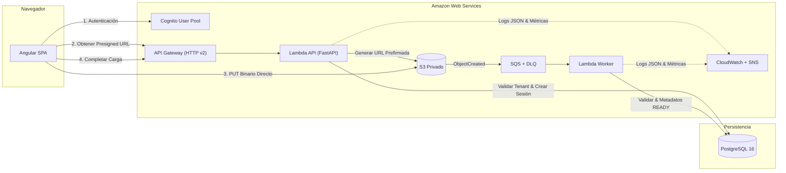

# Cloud Document Manager (CDM)

> **Plataforma Web SaaS Multi-Tenant para Almacenamiento, Catalogación y Procesamiento Seguro de Documentos en la Nube.**

[](https://github.com/CamiloTriana75/cloud-document-manager/actions/workflows/ci.yml)
[](https://www.python.org/)
[](https://angular.dev/)
[](https://www.terraform.io/)
[](https://www.postgresql.org/)
[](https://aws.amazon.com/)

---

## 1. Visión del Producto

**Cloud Document Manager (CDM)** es una solución SaaS diseñada bajo principios de arquitectura hexagonal, aislamiento multi-tenant estricto y computación serverless en AWS. Permite a organizaciones (*workspaces*) gestionar su patrimonio documental mediante:

- **Carga Directa Segura:** Transferencia binaria desde el navegador directo a Amazon S3 mediante URLs prefirmadas de vida corta (15 min).
- **Aislamiento Multi-Tenant No Negociable:** Particionamiento lógico en PostgreSQL mediante `workspace_id` y rutas físicas prefijadas en S3.
- **Procesamiento Asíncrono Desacoplado:** Canalización de eventos S3 mediante colas SQS, Dead Letter Queue (DLQ) y workers AWS Lambda.
- **Observabilidad Integral:** Logging estructurado JSON con sanitización automática en tiempo real de credenciales, correlación distribuida (`X-Request-ID` / SQS `messageId`) y alarmas CloudWatch.
- **Eficiencia Financiera:** Arquitectura 100% Serverless con cero costes fijos continuos (sin NAT Gateways ni balanceadores dedicados).

---

## 2. Stack Tecnológico

| Capa | Tecnología | Propósito |
|---|---|---|
| **Frontend** | Angular 22 + TypeScript + Signals | SPA reactiva zoneless, accesible (WCAG AA), carga S3 con progreso |
| **Backend API** | Python 3.12 + FastAPI + Mangum | Arquitectura Hexagonal, adaptadores ASGI Serverless y validación Pydantic |
| **Persistencia** | PostgreSQL 16 + SQLAlchemy 2.0 | Repositorios aislados por tenant, índices optimizados y migraciones Alembic |
| **Almacenamiento** | Amazon S3 Privado | SSE-S3 AES256, Block Public Access, CORS restringido y eventos de creación |
| **Procesamiento** | SQS + AWS Lambda Worker | Procesamiento asíncrono idempotente, Dead Letter Queue (DLQ) y reintentos x3 |
| **Identidad** | Amazon Cognito User Pool | Autenticación JWT, validación de JWKS en memoria y roles jerárquicos |
| **Observabilidad** | Amazon CloudWatch + SNS | Logs estructurados JSON, métricas de error/throttle y alertas operativas |
| **Infraestructura**| Terraform 1.7+ | Infraestructura como Código (IaC) modular y reproducible |
| **CI/CD** | GitHub Actions | Pipeline automatizado: ruff, mypy, pytest, ng lint, ng build, playwright |

---

## 3. Arquitectura del Sistema



> Diagrama detallado y descripción completa de componentes en [`docs/architecture/system-architecture.md`](docs/architecture/system-architecture.md).

---

## 4. Requisitos Previos

Asegúrate de contar con las siguientes herramientas instaladas localmente:

- **Docker Desktop** (o Docker Engine con Docker Compose v2)
- **Python 3.12+** y el gestor de paquetes **[uv](https://docs.astral.sh/uv/)** (>= 0.12)
- **Node.js 20+** (recomendado Node 22+) y **[pnpm](https://pnpm.io/)** (>= 9.0)
- **Terraform** (>= 1.7.0)
- **AWS CLI v2** (opcional para inspección o despliegue en la nube)
- **Git**

---

## 5. Puesta en Marcha en Entorno Local

El desarrollo local está optimizado para ejecutarse en segundos. Únicamente PostgreSQL corre en contenedor Docker; el backend y el frontend se ejecutan nativamente con recarga en caliente (*hot-reload*).

### 5.1 Configuración de Variables de Entorno
Copia la plantilla de entorno en la raíz del repositorio:

```bash
cp .env.example .env
```
*(Los valores por defecto de `.env.example` están preconfigurados para funcionar inmediatamente con el entorno local de Docker).*

### 5.2 Base de Datos Local (PostgreSQL)
Inicia el contenedor de base de datos PostgreSQL 16:

```bash
docker compose up -d
```
Verifica que el servicio esté saludable en `localhost:5432`:
```bash
docker compose ps
```

### 5.3 Backend API (FastAPI)
Accede al directorio del backend, sincroniza dependencias y ejecuta las migraciones:

```bash
cd apps/api

# 1. Sincronizar entorno virtual y dependencias fijadas
uv sync

# 2. Aplicar migraciones de base de datos
uv run alembic upgrade head

# 3. Iniciar servidor de desarrollo (hot reload)
uv run uvicorn cdm.bootstrap.app:app --reload --port 8000
```
- Endpoint de verificación de salud: `http://localhost:8000/health`
- Documentación OpenAPI interactiva: `http://localhost:8000/docs`

### 5.4 Frontend SPA (Angular 22)
En una nueva terminal, accede al directorio del frontend:

```bash
cd apps/web

# 1. Instalar dependencias con lockfile estricto
pnpm install --frozen-lockfile

# 2. Iniciar servidor de desarrollo Angular
pnpm start
```
Accede a la aplicación web en: `http://localhost:4200/`

---

## 6. Ejecución de la Suite de Pruebas y Calidad

El proyecto exige cobertura y calidad rigurosa en cada capa antes de fusionar cambios (*AGENTS.md* §15):

### Backend (Python)
```bash
cd apps/api

# Análisis estático y formateo de código
uv run ruff check .
uv run ruff format --check .

# Verificación de tipos estricta
uv run mypy src

# Suite de pruebas automatizadas (Unitarias, Integración, Contrato, Seguridad)
uv run pytest
```

### Frontend (Angular)
```bash
cd apps/web

# Verificación de estilos y linters
pnpm exec ng lint

# Compilación de producción (AOT + optimización)
pnpm exec ng build

# Pruebas unitarias de componentes y servicios
pnpm exec ng test --no-watch

# Pruebas End-to-End (Playwright)
pnpm exec playwright test
```

---

## 7. Despliegue en AWS (Entorno Dev)

> [!CAUTION]
> **RESTRICCIONES FINANCIERAS Y DE SEGURIDAD OBLIGATORIAS (*AGENTS.md* §13):**
> - Prohibido aprovisionar recursos continuos de alto coste (NAT Gateways, balanceadores dedicados, clusters EKS).
> - Se requiere autorización expresa del propietario antes de ejecutar `terraform apply` o cualquier comando con impacto económico.
> - Consultar el runbook de auditoría y costes en [`docs/runbooks/aws-account-audit.md`](docs/runbooks/aws-account-audit.md).

### 7.1 Inicialización de Terraform
```bash
cd infrastructure/terraform/environments/dev

# Inicializar proveedores y módulos locales
terraform init

# Validar sintaxis y coherencia de IaC
terraform fmt -check
terraform validate
```

### 7.2 Planificación y Revisión de Infraestructura
```bash
terraform plan -out=tfplan
```
Revisa detalladamente la lista de recursos a crear:
- Bucket S3 (`cdm-dev-documents-*`) con encriptación AES256 y bloqueo público.
- Funciones Lambda (`cdm-dev-api`, `cdm-dev-worker`) y API Gateway HTTP v2.
- Colas SQS (`cdm-dev-document-events-queue` y Dead Letter Queue).
- Cognito User Pool y App Client.
- Alarmas CloudWatch y Tópico SNS.

### 7.3 Aprobación y Aplicación
Una vez obtenida la aprobación expresa del propietario:
```bash
terraform apply tfplan
```

### 7.4 Destrucción y Teardown de Recursos
Para evitar cobros residuales tras completar pruebas en la nube, sigue el procedimiento documentado en [`docs/runbooks/aws-teardown.md`](docs/runbooks/aws-teardown.md):
```bash
# 1. Vaciar buckets S3 previamente (requerido por AWS)
# 2. Ejecutar destrucción controlada
terraform destroy
```

---

## 8. Guías y Documentación de Referencia

| Documento | Ubicación | Descripción |
|---|---|---|
| **Reglas del Proyecto** | [`AGENTS.md`](AGENTS.md) | Documento rector: estándares de ingeniería, arquitectura, seguridad y costos |
| **Arquitectura de Sistema** | [`docs/architecture/system-architecture.md`](docs/architecture/system-architecture.md) | Diagramas C4, componentes backend hexagonal y frontend zoneless |
| **Modelo de Dominio** | [`docs/architecture/domain-model.md`](docs/architecture/domain-model.md) | Entidades, value objects, invariantes y diagramas de estado |
| **Revisión de Seguridad OWASP** | [`docs/architecture/security-review-owasp.md`](docs/architecture/security-review-owasp.md) | Controles OWASP File Upload & API Security Top 10 |
| **Guía de Observabilidad** | [`docs/architecture/observability-guide.md`](docs/architecture/observability-guide.md) | Esquema JSON de logs, correlación y queries CloudWatch |
| **Runbook de Operaciones** | [`docs/runbooks/operations-runbook.md`](docs/runbooks/operations-runbook.md) | Diagnóstico Lambda/SQS/DLQ y mitigación de errores de carga |
| **Runbook Backup & Restore** | [`docs/runbooks/backup-restore.md`](docs/runbooks/backup-restore.md) | Backups PostgreSQL, reconciliación S3 y ciclo de vida de objetos |
| **Runbook Teardown AWS** | [`docs/runbooks/aws-teardown.md`](docs/runbooks/aws-teardown.md) | Guía de destrucción Terraform y checklist antes de expiración del plan |
| **Decisiones de Arquitectura** | [`docs/adr/`](docs/adr/README.md) | Registros de decisión arquitectónica (ADR-0001 a ADR-0008) |

---

## 9. Licencia y Colaboradores

- **Autor:** Camilo Triana (`jtriaha@gmail.com`)
- **Repositorio:** [CamiloTriana75/cloud-document-manager](https://github.com/CamiloTriana75/cloud-document-manager)
- **Licencia:** MIT (ver `LICENSE` si aplica).
