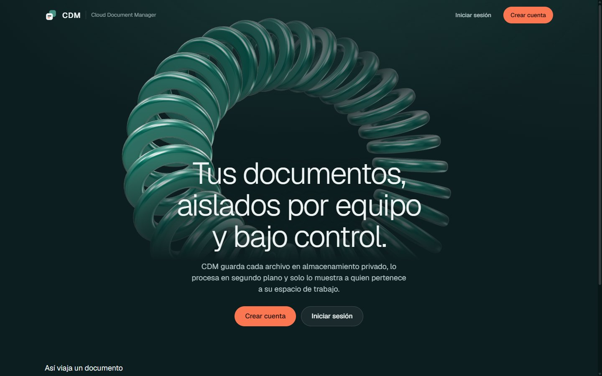
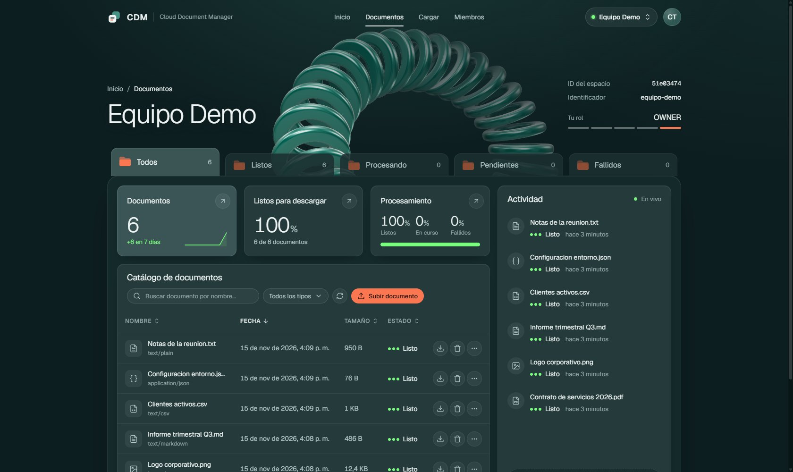
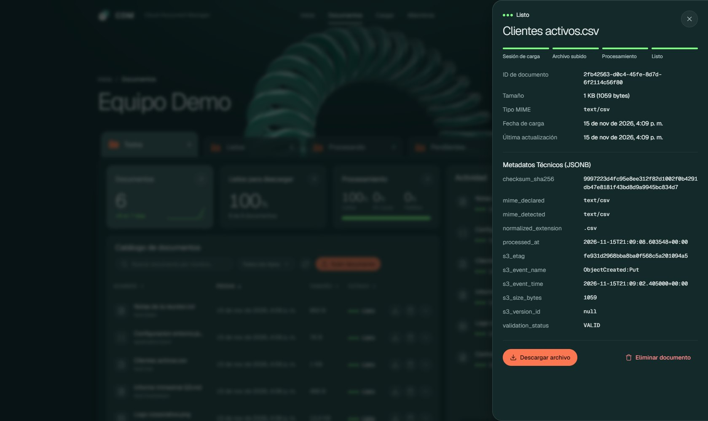
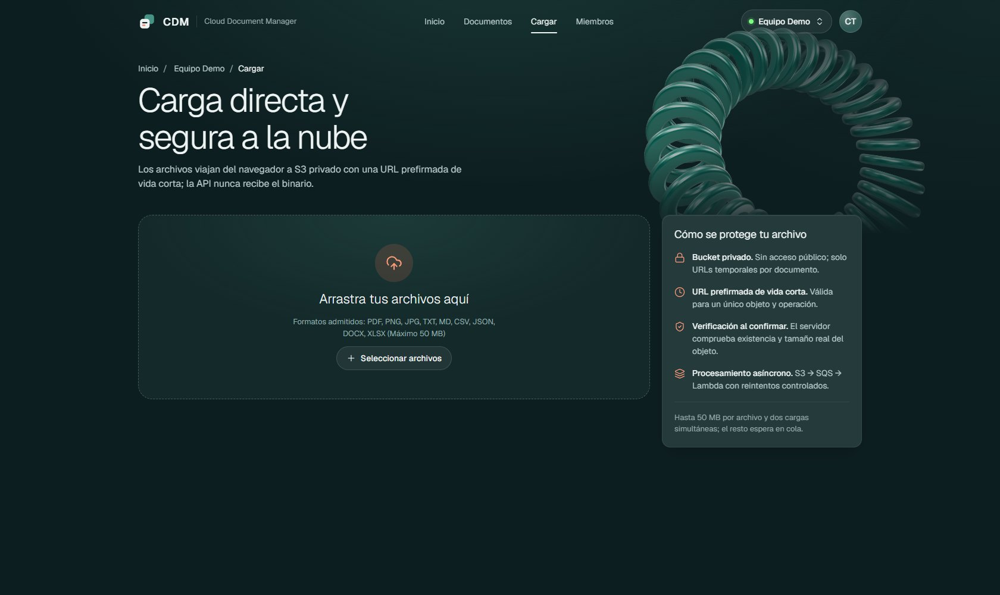
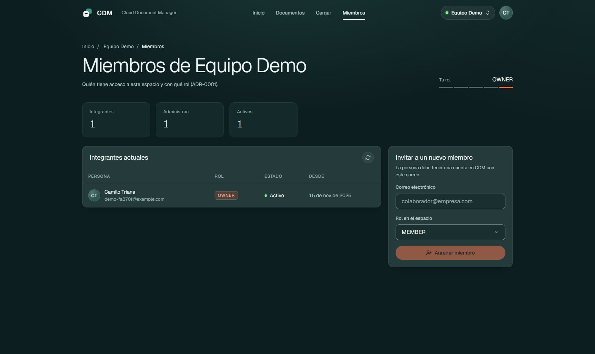
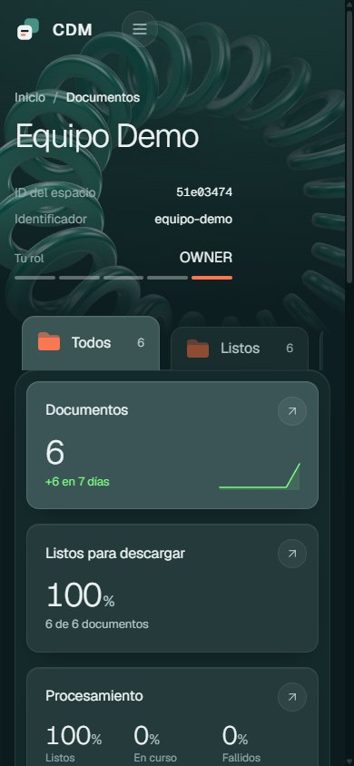
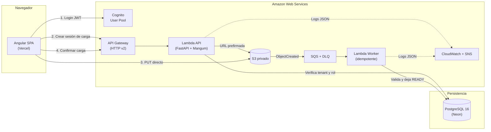

<div align="center">

# Cloud Document Manager (CDM)

**Plataforma SaaS multi-tenant para guardar, catalogar y procesar documentos de forma segura en la nube.**

Arquitectura hexagonal · aislamiento estricto entre organizaciones · carga directa a S3 · procesamiento asíncrono serverless

[](https://cloud-document-manager.vercel.app)
[](https://github.com/CamiloTriana75/cloud-document-manager/actions/workflows/ci.yml)


<br />

<a href="https://cloud-document-manager.vercel.app">
  
</a>

**[→ Probar la demo en vivo](https://cloud-document-manager.vercel.app)**

</div>

---

## Contenido

- [Qué demuestra este proyecto](#qué-demuestra-este-proyecto)
- [Probar la demo](#probar-la-demo)
- [Recorrido por la aplicación](#recorrido-por-la-aplicación)
- [Arquitectura](#arquitectura)
- [Decisiones técnicas](#decisiones-técnicas)
- [Seguridad y multi-tenancy](#seguridad-y-multi-tenancy)
- [Calidad y pruebas](#calidad-y-pruebas)
- [Stack tecnológico](#stack-tecnológico)
- [Estructura del repositorio](#estructura-del-repositorio)
- [Ejecutarlo en local](#ejecutarlo-en-local)
- [Despliegue en la nube](#despliegue-en-la-nube)
- [Estado y límites conocidos](#estado-y-límites-conocidos)
- [Documentación](#documentación)

---

## Qué demuestra este proyecto

CDM no es un CRUD de ejemplo: es un producto de extremo a extremo, desplegado y verificado en la nube, construido para mostrar criterio de ingeniería en cada capa.

| Área | Lo que se puede ver en el código |
|---|---|
| **Backend** | Python 3.12 + FastAPI con **arquitectura hexagonal** (dominio, casos de uso, puertos y adaptadores), validación con Pydantic, SQLAlchemy 2 y migraciones Alembic. |
| **Multi-tenancy** | Aislamiento por *workspace* con 5 roles jerárquicos. El tenant se resuelve siempre desde la membresía guardada en base de datos, nunca desde lo que envía el cliente (prevención de IDOR/BOLA). |
| **Cloud / AWS** | API Gateway + Lambda, Cognito, S3 privado, SQS con *dead-letter queue* y worker idempotente, CloudWatch y SNS. Cero costes fijos: sin NAT, sin balanceadores, sin RDS. |
| **Infraestructura como código** | **9 módulos Terraform** reutilizables, planes revisados antes de cada `apply` y CI que valida formato y sintaxis. |
| **Frontend** | Angular 22 *zoneless* con signals, accesibilidad **WCAG AA verificada en CI**, sistema de diseño propio y una escena 3D (three.js) cargada bajo demanda. |
| **Calidad** | **279 pruebas de backend, 192 unitarias de frontend y 18 E2E**, incluida una matriz de aislamiento entre tenants. |
| **Proceso** | 11 ADR de decisiones, runbooks operativos, *Conventional Commits* ligados a Jira, ramas por incremento y pull requests con pruebas descritas. |

---

## Probar la demo

**https://cloud-document-manager.vercel.app**

1. Pulsa **Crear cuenta** y regístrate con un correo real. Amazon Cognito envía un código de 6 dígitos a tu correo.
2. Confirma la cuenta con el código e inicia sesión.
3. Crea un espacio de trabajo y sube un archivo (PDF, imagen, Markdown, CSV, JSON, TXT, DOCX o XLSX, hasta 50 MB).
4. Observa cómo pasa de **Pendiente → Subido → Procesando → Listo**, abre su detalle técnico y descárgalo con una URL temporal.

> La demo corre sobre servicios *serverless* en capa gratuita: tras un rato sin uso, la primera petición puede tardar unos segundos (arranque en frío de Lambda y de la base de datos).

---

## Recorrido por la aplicación

### Dashboard del espacio de trabajo

Carpetas por estado con conteos reales, KPIs calculados con la API, catálogo con búsqueda y filtros, y un panel de actividad que se actualiza solo mientras el worker procesa los archivos.



### Detalle técnico de cada documento

La línea de tiempo del procesamiento y los metadatos que extrae el worker: huella **SHA-256**, tipo MIME declarado frente al **detectado por el contenido**, ETag de S3 y estado de validación.



### Carga directa y segura a S3

El navegador envía el archivo **directamente a S3** con una URL prefirmada de vida corta; la API nunca recibe el binario. Hay cola de varios archivos, progreso por archivo, cancelación y reintento.



### Miembros y roles

Administración de personas y roles por espacio de trabajo. Los permisos se reflejan en la interfaz, pero **los decide siempre el backend**.



### Diseño responsive

<p align="center">
  
</p>

---

## Arquitectura



**Flujo de un documento:** el usuario pide una sesión de carga → la API valida identidad, rol y política de archivos y devuelve una URL prefirmada → el navegador sube el archivo a S3 → la API verifica el objeto real (existencia y tamaño) → S3 notifica a SQS → el worker inspecciona el contenido (el tipo MIME real, no solo la extensión), calcula el SHA-256 y deja el documento en `READY`, todo de forma idempotente y con reintentos acotados.

La arquitectura de código sigue puertos y adaptadores: las dependencias apuntan siempre hacia el dominio.

```text
apps/api/src/cdm/
├── domain/            entidades, value objects e invariantes (sin frameworks)
├── application/       casos de uso y puertos (contratos con el exterior)
├── adapters/
│   ├── inbound/http/  routers FastAPI delgados
│   └── outbound/      PostgreSQL, S3, Cognito/JWKS
└── bootstrap/         composición de dependencias y handlers de Lambda
```

Diagramas detallados en [`docs/architecture/system-architecture.md`](docs/architecture/system-architecture.md).

---

## Decisiones técnicas

Cada decisión relevante está registrada con contexto, alternativas, consecuencias y riesgos.

| ADR | Decisión | Por qué |
|---|---|---|
| [0001](docs/adr/0001-roles-de-workspace.md) | 5 roles jerárquicos (`VIEWER` < `MEMBER` < `EDITOR` < `ADMIN` < `OWNER`) | Permisos claros sin complejidad de ACL por documento |
| [0002](docs/adr/0002-fastapi-lambda-mangum.md) | FastAPI sobre Lambda con Mangum | Una sola base de código ejecutable en local y en serverless |
| [0004](docs/adr/0004-s3-presigned-upload.md) | Carga directa a S3 con URL prefirmada | El binario no pasa por la API: menos coste y superficie de ataque |
| [0005](docs/adr/0005-sqs-lambda-worker.md) | S3 → SQS → Lambda con DLQ | Procesamiento desacoplado, reintentos controlados y mensajes inspeccionables |
| [0006](docs/adr/0006-multi-tenant-y-usuarios.md) | Multi-tenancy por `workspace_id` resuelto en servidor | Protección frente a IDOR aunque se conozca un UUID |
| [0008](docs/adr/0008-postgres-local-vs-rds.md) | RDS diferido por coste | RDS no tiene capa gratuita; la arquitectura permite cambiar la base de datos sin tocar el dominio |
| [0009](docs/adr/0009-escena-3d-three-js.md) | Escena 3D con three.js en un *chunk* aparte | La dependencia pesada (~113 kB) no entra en la carga inicial |
| [0010](docs/adr/0010-postgresql-gestionado-neon.md) | PostgreSQL gestionado en Neon | Accesible desde Lambda sin VPC ni NAT y sin coste fijo |
| [0011](docs/adr/0011-frontend-en-vercel.md) | Frontend en Vercel | HTTPS, CDN y despliegue por Git sin coste |

Índice completo en [`docs/adr/`](docs/adr/README.md).

---

## Seguridad y multi-tenancy

- **Autenticación real:** Cognito emite los JWT; la API verifica firma (JWKS con caché y rotación), emisor, expiración, `token_use` y audiencia. No existe ningún atajo en la nube: un token sin firma recibe `401`.
- **Aislamiento entre organizaciones:** cada consulta se filtra por el `workspace_id` de una membresía activa. Un usuario ajeno recibe `404`, sin revelar que el recurso existe. Hay una [matriz automatizada de aislamiento](docs/architecture/multi-tenant-security-matrix.md).
- **Archivos:** bucket privado con *Block Public Access* y cifrado, claves opacas generadas en el servidor, lista de formatos permitidos, límite de tamaño y verificación del contenido real, nunca solo de la extensión o del `Content-Type` declarado.
- **URLs prefirmadas** de un solo objeto y operación, con expiración corta, que nunca se registran en los logs.
- **Observabilidad sin fugas:** logs JSON estructurados con correlación por petición y sanitización automática de tokens y URLs firmadas.
- **Mínimo privilegio** en IAM, CORS restringido a los orígenes exactos y cabeceras de seguridad en el frontend.

Revisión completa contra OWASP en [`docs/architecture/security-review-owasp.md`](docs/architecture/security-review-owasp.md).

---

## Calidad y pruebas

| Capa | Herramientas | Resultado |
|---|---|---|
| **Backend** | pytest (unitarias, contrato e integración contra PostgreSQL real), Ruff, mypy en modo estricto | **279 pruebas** |
| **Frontend** | Vitest, angular-eslint (con reglas de accesibilidad de plantillas) | **192 pruebas** |
| **E2E** | Playwright con API simulada: login, catálogo, carga, miembros y permisos por rol | **18 recorridos** |
| **Accesibilidad** | Script propio que verifica el contraste de los tokens de color | **33 pares WCAG AA** |
| **Nube** | `scripts/cloud_smoke_test.py` contra el entorno desplegado | **19 comprobaciones**: login real, carga a S3, procesamiento hasta `READY`, descarga, aislamiento y borrado |
| **Infraestructura** | `terraform fmt`, `validate` y revisión del plan antes de aplicar | Sin recursos de coste continuo |

La integración continua ejecuta todo esto en cada pull request. El *bundle* inicial del frontend es de **~91 kB** transferidos.

---

## Stack tecnológico

| Capa | Tecnología |
|---|---|
| **Frontend** | Angular 22 (standalone, zoneless, signals) · TypeScript estricto · three.js bajo demanda · Vitest · Playwright |
| **Backend** | Python 3.12 · FastAPI · Pydantic · SQLAlchemy 2 · Alembic · Mangum |
| **Datos** | PostgreSQL 16 (Neon en la nube, Docker en local) |
| **Cloud** | AWS: API Gateway HTTP, Lambda, S3, SQS (+DLQ), Cognito, CloudWatch, SNS · Vercel |
| **Infra y CI/CD** | Terraform · GitHub Actions · Docker Compose · uv · pnpm |

---

## Estructura del repositorio

```text
cloud-document-manager/
├── apps/
│   ├── api/            backend FastAPI (arquitectura hexagonal) + pruebas
│   └── web/            frontend Angular + pruebas unitarias y E2E
├── infrastructure/
│   └── terraform/      módulos reutilizables y entorno dev
├── docs/
│   ├── adr/            decisiones de arquitectura
│   ├── architecture/   diseño, seguridad, observabilidad, design system
│   ├── runbooks/       despliegue, operaciones, DLQ, backup y teardown
│   └── images/         capturas de este README
├── scripts/            empaquetado de Lambda, smoke test de la nube, S3 local
├── compose.yaml        PostgreSQL y emulador de S3 para desarrollo
└── AGENTS.md           reglas de ingeniería del proyecto
```

---

## Ejecutarlo en local

En local no hace falta cuenta de AWS: PostgreSQL y un emulador de S3 (moto) corren en Docker, y la autenticación usa un modo de desarrollo sin Cognito.

**Requisitos:** Docker, Python 3.12+ con [uv](https://docs.astral.sh/uv/), Node.js 22+ con [pnpm](https://pnpm.io/) 12 y Git.

```bash
# 1. Variables de entorno
cp .env.example .env
#    Para el flujo completo sin AWS, añade a .env:
#      CDM_AUTH_MOCK_ENABLED=true               (tokens sin firma; prohibido con CDM_ENV=prod)
#      CDM_S3_BUCKET_NAME=cdm-documents-dev
#      CDM_S3_ENDPOINT_URL=http://localhost:9000

# 2. PostgreSQL y emulador de S3
docker compose up -d
uv run --project apps/api python scripts/init_local_s3.py   # crea el bucket local (una vez)

# 3. Backend (http://localhost:8000/docs)
cd apps/api
uv sync
uv run alembic upgrade head
AWS_ACCESS_KEY_ID=test AWS_SECRET_ACCESS_KEY=test uv run uvicorn cdm.bootstrap.app:app --reload --port 8000

# 4. Frontend (http://localhost:4200), en otra terminal
cd apps/web
pnpm install --frozen-lockfile
pnpm start
```

Con el modo de desarrollo puedes iniciar sesión con cualquier correo y una contraseña de 6 o más caracteres. En local no corre el worker de SQS, así que los documentos se quedan en *Subido*.

### Comandos de calidad

```bash
# Backend
cd apps/api && uv run ruff check . && uv run ruff format --check . && uv run mypy && uv run pytest

# Frontend
cd apps/web && pnpm exec ng lint && pnpm exec ng build && pnpm exec ng test --no-watch \
  && pnpm run check:contrast && pnpm run e2e
```

---

## Despliegue en la nube

El entorno `dev` está desplegado y verificado:

| Pieza | Servicio |
|---|---|
| Frontend | Vercel ([cloud-document-manager.vercel.app](https://cloud-document-manager.vercel.app)), redespliegue automático desde `main` |
| API | API Gateway HTTP → Lambda (FastAPI) |
| Base de datos | PostgreSQL 16 en Neon, región `us-east-1` |
| Identidad | Cognito User Pool con App Client sin secreto |
| Archivos y eventos | S3 privado → SQS (+DLQ) → Lambda worker |
| Observabilidad | CloudWatch (logs y alarmas) y SNS |

```bash
cd infrastructure/terraform/environments/dev
export TF_VAR_database_url='postgresql+psycopg://...?sslmode=require'   # nunca en archivos
terraform plan -out=tfplan      # revisar antes de aplicar
terraform apply tfplan          # solo con aprobación del propietario
```

> **Reglas de coste y seguridad (AGENTS.md §13):** sin NAT Gateway ni recursos de coste continuo, y ningún `apply` sin revisar el plan. La guía de destrucción segura está en [`docs/runbooks/aws-teardown.md`](docs/runbooks/aws-teardown.md).

Procedimiento completo, verificación y diagnóstico: [`docs/runbooks/cloud-deployment.md`](docs/runbooks/cloud-deployment.md).

---

## Estado y límites conocidos

Un proyecto honesto dice también lo que todavía no hace:

- **Es un entorno de desarrollo en capa gratuita.** La cuenta de AWS tiene un límite de 10 ejecuciones concurrentes de Lambda; el frontend reintenta las lecturas ante saturación y el worker está limitado a 2 ejecuciones, pero con mucha concurrencia habría errores `503`.
- **El procesamiento es básico:** valida el contenido real, calcula el SHA-256 y extrae metadatos técnicos. No hay OCR, búsqueda semántica ni análisis de malware, y está fuera del alcance del MVP.
- **La cadena de conexión de la base de datos** vive como variable cifrada de la Lambda; para producción convendría moverla a SSM Parameter Store o Secrets Manager.
- **Falta una Content-Security-Policy** en el frontend (el resto de cabeceras de seguridad sí está).
- **Las invitaciones no envían correo:** al añadir a alguien por su correo, verá el espacio la próxima vez que inicie sesión con ese correo verificado.

---

## Documentación

| Documento | Descripción |
|---|---|
| [`AGENTS.md`](AGENTS.md) | Reglas de ingeniería, arquitectura, seguridad y costes del proyecto |
| [`docs/architecture/system-architecture.md`](docs/architecture/system-architecture.md) | Arquitectura del sistema y componentes |
| [`docs/architecture/domain-model.md`](docs/architecture/domain-model.md) | Entidades, invariantes y estados |
| [`docs/architecture/design-system.md`](docs/architecture/design-system.md) | Sistema de diseño del frontend |
| [`docs/architecture/security-review-owasp.md`](docs/architecture/security-review-owasp.md) | Revisión de seguridad |
| [`docs/runbooks/cloud-deployment.md`](docs/runbooks/cloud-deployment.md) | Despliegue en la nube, smoke test y diagnóstico |
| [`docs/runbooks/operations-runbook.md`](docs/runbooks/operations-runbook.md) | Operación: Lambda, SQS y DLQ |
| [`docs/releases/v0.1.0-release-notes.md`](docs/releases/v0.1.0-release-notes.md) | Notas de la primera versión |
| [`CHANGELOG.md`](CHANGELOG.md) | Historial de cambios |

---

<div align="center">

Construido por **[Camilo Triana](https://github.com/CamiloTriana75)**

</div>
