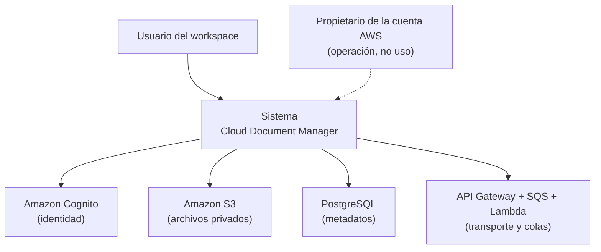
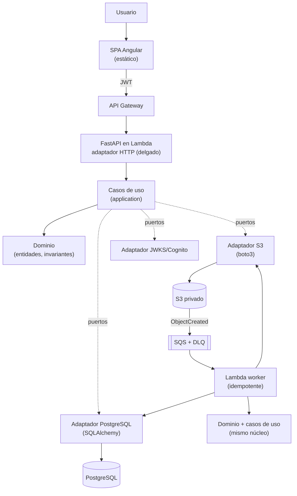
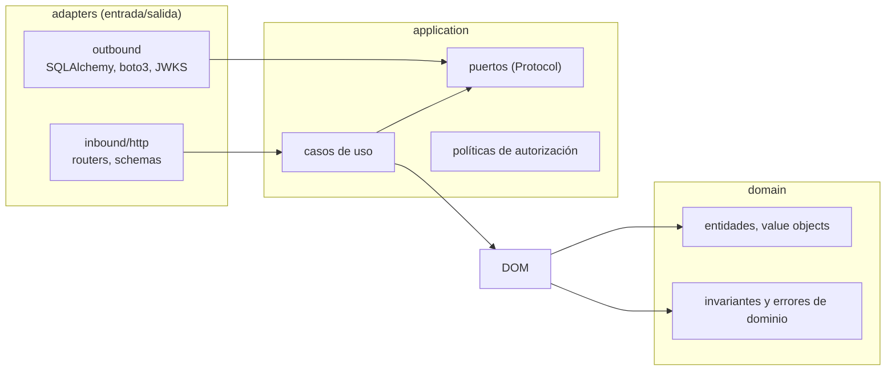
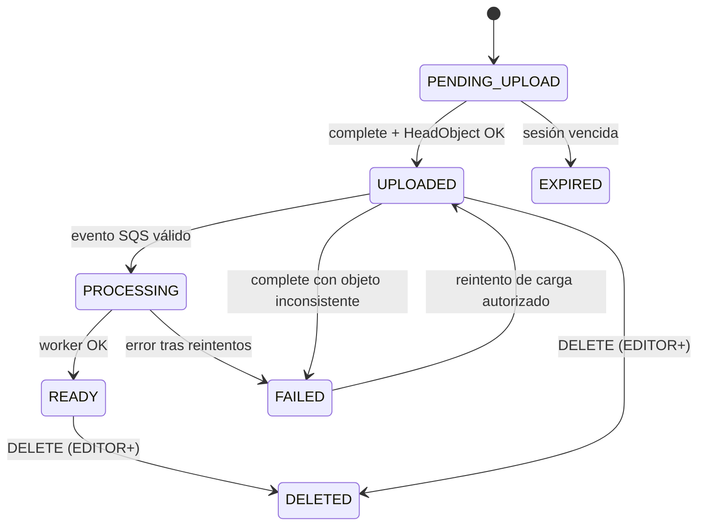

# Modelo de dominio — CDM

> Jira: **CDM-11** (subtarea CDM-57) · Fecha: 2026-11-12 · Estado: Aceptado
> Regla de dependencias (AGENTS.md §8): el dominio **no** importa FastAPI, SQLAlchemy, boto3, Pydantic ni ningún framework.

## 1. Diagrama de contexto (C4 nivel 1)

## 2. Diagrama de contenedores (C4 nivel 2)

## 3. Límites entre capas

- Dependencias **solo** apuntan hacia `domain`. `domain` no conoce a nadie.
- `application` define puertos; `adapters/outbound` los implementa.
- `inbound/http` es delgado: autentica, traduce a DTOs de aplicación, llama casos de uso y mapea errores tipados a HTTP.

## 4. Entidades e invariantes

### 4.1 `UserReference`

Referencia local del usuario de Cognito. No almacena credenciales.

| Campo | Regla |
|---|---|
| `id` | UUID, identidad local. |
| `cognito_sub` | Obligatorio, único. Es el vínculo con el JWT. |
| `email` | Opcional/normalizado; **nunca** identificador de autorización. |
| `display_name` | Opcional. |

Invariantes: `cognito_sub` inmutable tras alta; el usuario existe tras primer login válido (provisión lazy o post-registro, ADR-0006).

### 4.2 `Workspace` (tenant)

| Campo | Regla |
|---|---|
| `id` | UUID PK. |
| `name` | 1..150 chars, mostrado en UI. |
| `slug` | Único global, `[a-z0-9-]{3,63}`, usado en URLs visibles pero **nunca** como prueba de autorización. |
| `created_by` | FK a `UserReference`; primer `OWNER`. |

Invariantes: un workspace tiene exactamente un `OWNER` activo; no se elimina físicamente sin decisión explícita (fuera del MVP).

### 4.3 `Membership`

| Campo | Regla |
|---|---|
| `workspace_id`, `user_id` | Único par `(workspace_id, user_id)`. |
| `role` | `OWNER \| ADMIN \| EDITOR \| MEMBER \| VIEWER` (ADR-0001). |
| `status` | `ACTIVE \| INVITED \| SUSPENDED`. |

Invariantes:
- Exactamente un `OWNER` `ACTIVE` por workspace (transfiere: nuevo OWNER + degradación del anterior, en una transacción).
- Solo `ACTIVE` otorga capacidades; `INVITED`/`SUSPENDED` no autorizan nada.
- El rol vive aquí, nunca en el JWT ni en el cliente.

### 4.4 `Document`

| Campo | Regla |
|---|---|
| `id` | UUID PK. |
| `workspace_id` | FK, obligatorio, indexado. **Toda** consulta incluye este filtro. |
| `uploaded_by` | FK a `UserReference`. |
| `original_filename` | Nombre saneado para presentación (sin rutas, ≤ 255). |
| `storage_key` | Único, opaco, generado en servidor: `workspaces/{workspace_id}/documents/{uuid}` — particionado por tenant (charter §7); el nombre del cliente nunca forma parte de la key. |
| `content_type` | Validado contra allowlist; el worker re-verifica el tipo real. |
| `size_bytes` | > 0 y ≤ límite configurado. |
| `checksum_sha256` | Lo calcula el worker (cliente no confiable). |
| `status` | Ciclo de §4.6. |
| `technical_metadata` | JSONB no crítico; solo lo escribe `EDITOR`+. |
| `deleted_at` | Set solo en eliminación lógica. |

Invariantes:
- El documento pertenece a exactamente un workspace; no se mueve entre tenants.
- `size_bytes` y `content_type` confirmados solo tras verificar el objeto real en S3.
- Sin `checksum_sha256` confiable, no se afirma integridad en la UI.

### 4.5 `UploadSession`

| Campo | Regla |
|---|---|
| `workspace_id`, `user_id` | Propietario de la sesión. |
| `document_id` | Documento provisional asociado (estado `PENDING_UPLOAD`). |
| `storage_key` | Generada en servidor, coincide con la del documento. |
| `expected_size`, `expected_content_type` | Declarados por el cliente, solo como pre-chequeo. |
| `status` | `PENDING → COMPLETED → CONFIRMED` / `EXPIRED` / `CANCELLED`. |
| `expires_at` | Obligatorio (por defecto 30 min, `mvp-journeys.md` §4). |

Invariantes:
- Una sesión es de un solo uso: `CONFIRMED`/`EXPIRED`/`CANCELLED` son terminales.
- `complete` solo con membership activa del `user_id` de la sesión.
- Expiración: la sesiones vencidas dejan objetos en `staging/` limpiados por lifecycle; nunca tocan documentos confirmados.

### 4.6 Ciclo de vida de `Document`

Invariantes de transición (validadas en dominio/caso de uso):
- Prohibido retroceder: ningún evento repetido lleva `READY`→`PROCESSING` ni `UPLOADED`→`PENDING_UPLOAD`.
- `DELETED` es terminal; el acceso posterior devuelve 404 sin revelar existencia.
- `EXPIRED` solo desde `PENDING_UPLOAD` (nunca hay objetos confirmados detrás).

### 4.7 `AuditEvent`

| Campo | Regla |
|---|---|
| `workspace_id` | Contexto del evento. |
| `actor_user_id` | Quién (null para eventos del sistema). |
| `action` | Enum: `workspace.created`, `member.role_changed`, `document.uploaded`, `document.deleted`, … |
| `target_type` / `target_id` | Workspace, membership o documento. |
| `created_at` | Inmutable. |

Invariantes: **nunca** se registran tokens, URLs prefirmadas, contenido de archivos ni datos sensibles (AGENTS.md §14); append-only.

## 5. Reglas transversales del dominio

1. Toda operación sobre documento exige membership `ACTIVE` en su workspace (resuelta en backend desde JWT + DB).
2. Las consultas de documentos/miembros siempre filtran por `workspace_id` autorizado; prohibido "cargar global y comprobar después" (anti-IDOR).
3. La matriz de permisos (`mvp-journeys.md` §3) vive en un único componente de política en `application`; se reutiliza, no se duplica.
4. Entidades y value objects sin llamadas de red ni constructores con I/O.
5. Errores tipados del dominio (`WorkspaceNotFoundError`, `NotAMemberError`, `InvalidDocumentStateError`, `FilePolicyViolationError`, …) mapeados centralizadamente a HTTP en el adaptador.
