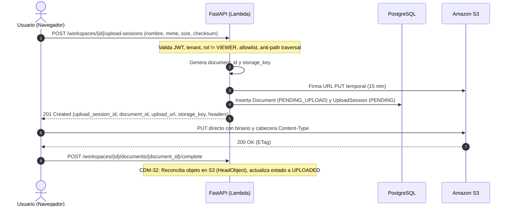

# Política de Carga de Archivos y Validación de Ingesta (CDM-29 / CDM-30)

> Especificación técnica y defensiva del flujo de carga de documentos a Amazon S3 y validación de políticas en Cloud Document Manager (CDM). Cumple con AGENTS.md §3, §10, §12 y §14.

---

## 1. Contexto y Objetivos

Para mantener una arquitectura serverless escalable, de bajo coste y segura:
1. **Ningún binario atraviesa la API FastAPI.** El navegador transfiere el archivo directamente a un bucket Amazon S3 privado mediante una URL temporal prefirmada (`PUT`).
2. **Defensa en profundidad en el borde:** Toda solicitud de sesión de carga se autentica, se valida contra la pertenencia al tenant, se verifica contra la allowlist estricta y se controla el tamaño y nombre antes de generar la URL prefirmada.
3. **Cero credenciales AWS en el cliente:** El navegador solo recibe una URL prefirmada HTTPS con firma SigV4 de corta duración y las cabeceras HTTP obligatorias (`Content-Type`).

---

## 2. Allowlist de Tipos MIME y Extensiones

Para el MVP de CDM, solo se admiten formatos de documentos y archivos de datos comunes:

| Tipo MIME | Extensiones Válidas | Descripción |
|---|---|---|
| `application/pdf` | `.pdf` | Documentos PDF |
| `image/png` | `.png` | Imágenes PNG |
| `image/jpeg` | `.jpg`, `.jpeg` | Imágenes JPEG |
| `text/plain` | `.txt` | Texto plano |
| `text/markdown` | `.md`, `.markdown` | Documentación Markdown |
| `text/csv` | `.csv` | Tablas de datos CSV |
| `application/json` | `.json` | Documentos estructurados JSON |
| `application/vnd.openxmlformats-officedocument.wordprocessingml.document` | `.docx` | Documentos Word OpenXML |
| `application/vnd.openxmlformats-officedocument.spreadsheetml.sheet` | `.xlsx` | Hojas de cálculo Excel OpenXML |

### Validación cruzada (Anti-Spoofing)
- No se confía ciegamente en el `Content-Type` reportado por el navegador ni en la extensión aislada.
- Se exige que la extensión del archivo pertenezca obligatoriamente al conjunto de extensiones permitidas para el MIME declarado.
- Un archivo con extensión no autorizada (p. ej. `.exe`, `.sh`, `.html`, `.bat`) o con discrepancia entre MIME y extensión es rechazado de inmediato con `415 Unsupported Media Type` (`file_type_not_allowed`).

---

## 3. Controles Defensivos del Nombre de Archivo

El nombre original enviado por el cliente es tratado como **metadato no confiable**:

1. **Anti-Path Traversal:** Se rechaza tajantemente cualquier nombre que contenga secuencias relativas `..`, separadores de directorio `/` o `\\`, o esquemas de unidad de disco (`C:`).
2. **Caracteres de control y nulos:** Se rechazan nombres con bytes nulos (`\0`) o caracteres con código ASCII < 32 o 127.
3. **Longitud:** Máximo 255 caracteres, no vacío ni conformado exclusivamente por espacios en blanco.
4. **Respuesta ante violación:** Código HTTP `422 Unprocessable Entity` con código de error `invalid_file_name`.

---

## 4. Generación de Claves S3 en el Servidor (Storage Keys)

El cliente nunca propone ni controla la ruta física en S3. La clave es generada exclusivamente por el backend mediante:

```python
storage_key = f"workspaces/{workspace_id}/documents/{document_id}/{opaque_token}{extension}"
```

Donde:
- `workspace_id`: Aísla y particiona físicamente los objetos por tenant en S3.
- `document_id`: UUID único e inmutable del documento.
- `opaque_token`: Token aleatorio de 32 caracteres hexadecimales (`uuid4().hex`) que previene colisiones y ataques de adivinación.
- `extension`: Extensión validada en minúsculas.

---

## 5. Límites de Tamaño y Verificación de Integridad

1. **Tamaño mínimo:** 1 byte (se rechazan archivos vacíos o de tamaño negativo).
2. **Tamaño máximo configurable:** Predeterminado en 50 MB (`52,428,800` bytes), configurable vía `CDM_MAX_UPLOAD_SIZE_BYTES`.
3. **Violación de tamaño:** Devuelve `413 Payload Too Large` (`file_size_exceeded`).
4. **Checksum SHA-256:** Parámetro opcional en la sesión de carga. Si es provisto, debe ser una cadena hexadecimal exacta de 64 caracteres.

---

## 6. Ciclo de Vida: Two-Phase Upload



---

## 7. Matriz de Autorización

| Rol | Solicitar Sesión de Carga | Código HTTP |
|---|---|---|
| `OWNER` | Permitido | `201 Created` |
| `ADMIN` | Permitido | `201 Created` |
| `EDITOR` | Permitido | `201 Created` |
| `MEMBER` | Permitido | `201 Created` |
| `VIEWER` | Denegado | `403 Forbidden` (`permission_denied`) |
| Externo / No miembro | Denegado | `404 Not Found` (`workspace_not_found`) |
