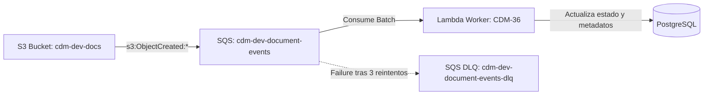

# Arquitectura de Eventos S3, SQS y Dead Letter Queue (CDM-35)

> Jira: **CDM-35** · Fecha: 2026-11-12
> Regla rectora: [`AGENTS.md`](../../AGENTS.md) §6, §12 (Procesamiento asíncrono y desacoplamiento).

Este documento especifica el canal de mensajería asíncrono que transporta los eventos de creación de objetos en Amazon S3 hacia la cola SQS de procesamiento y su Dead Letter Queue (DLQ).

---

## 1. Topología del Flujo de Eventos



1. **Emisor (S3):** Tras un `PUT` directo o multipart completion bajo el prefijo `tenants/`, S3 emite una notificación `s3:ObjectCreated:*`.
2. **Cola Principal (SQS):** Encola los eventos para consumo desacoplado, amortiguando picos de carga.
3. **Consumidor (Lambda Worker):** Procesa los eventos de manera idempotente (CDM-36).
4. **Dead Letter Queue (DLQ):** Captura mensajes que fallan reiteradamente para evitar bucles infinitos de consumo y pérdida de mensajes.

---

## 2. Parámetros y Umbrales de Configuración

| Parámetro | Valor Configurado | Justificación Técnica / Criterio |
|---|---|---|
| **`visibility_timeout_seconds`** | `180` (3 minutos) | **Criterio 4:** Coherente con la recomendación oficial de AWS de configurar el timeout de visibilidad a **6x** la duración máxima de la función Lambda worker (30 segundos). Previene que mensajes en procesamiento concurrente reaparezcan prematuramente. |
| **`maxReceiveCount` (Redrive Policy)** | `3` | **Criterio 2:** Número de entregas antes de derivar el mensaje a la DLQ. Permite tolerar fallos transitorios de red o contención en BD sin saturar recursos. |
| **`receive_wait_time_seconds`** | `20` (Long Polling) | Reduce drásticamente llamadas API vacías a SQS y disminuye el coste a $0 dentro del Free Tier perpetuo (1M peticiones/mes). |
| **`message_retention_seconds` (Principal)** | `345600` (4 días) | Margen amplio para recuperación ante mantenimiento o indisponibilidad temporal del worker. |
| **`dlq_message_retention_seconds`** | `1209600` (14 días) | Tiempo máximo de retención para diagnóstico forense, alarmas en CloudWatch y re-drive manual. |
| **Cifrado en reposo** | `SSE-SQS` (AES-256) | Cifrado gestionado sin coste adicional de peticiones KMS ($0). |

---

## 3. Seguridad y Mínimo Privilegio (Criterio 3)

La cola principal está protegida por una política de acceso `aws_sqs_queue_policy` que otorga acceso exclusivamente a `s3.amazonaws.com` mediante condiciones estrictas:

```json
{
  "Version": "2012-10-17",
  "Statement": [
    {
      "Sid": "AllowS3BucketToPublishEvents",
      "Effect": "Allow",
      "Principal": {
        "Service": "s3.amazonaws.com"
      },
      "Action": "sqs:SendMessage",
      "Resource": "arn:aws:sqs:us-east-1:<account_id>:cdm-dev-document-events",
      "Condition": {
        "ArnEquals": {
          "aws:SourceArn": "arn:aws:s3:::cdm-dev-docs-<account_id>"
        },
        "StringEquals": {
          "aws:SourceAccount": "<account_id>"
        }
      }
    }
  ]
}
```

- **`aws:SourceArn`:** Limita el emisor únicamente al bucket exacto del proyecto.
- **`aws:SourceAccount`:** Mitiga el problema de seguridad del "deputy confuso".

---

## 4. Estructura de Mensaje y Ausencia de Datos Sensibles (Criterio 5)

Las notificaciones de S3 transportan metadatos puramente técnicos del almacenamiento:
- `bucket.name`: Nombre del bucket S3.
- `object.key`: Clave estructurada bajo `tenants/<workspace_id>/documents/<document_id>/<opaque_name>`.
- `object.size`: Tamaño real en bytes registrado en S3.
- `object.eTag`: ETag del objeto para validación de checksum / coherencia.
- `object.versionId`: Identificador de versión si el versionado estuviera activo.

> [!NOTE]
> El payload de S3 **NO** contiene tokens de usuario, credenciales, datos de autenticación ni contenido confidencial del archivo. El worker recupera el contexto de autorización a partir del esquema de clave y la persistencia en PostgreSQL.
