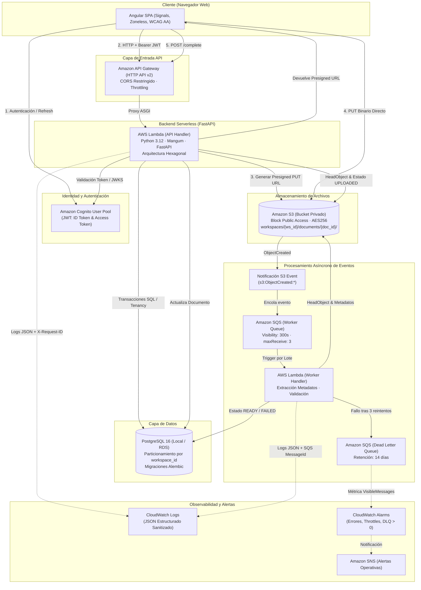
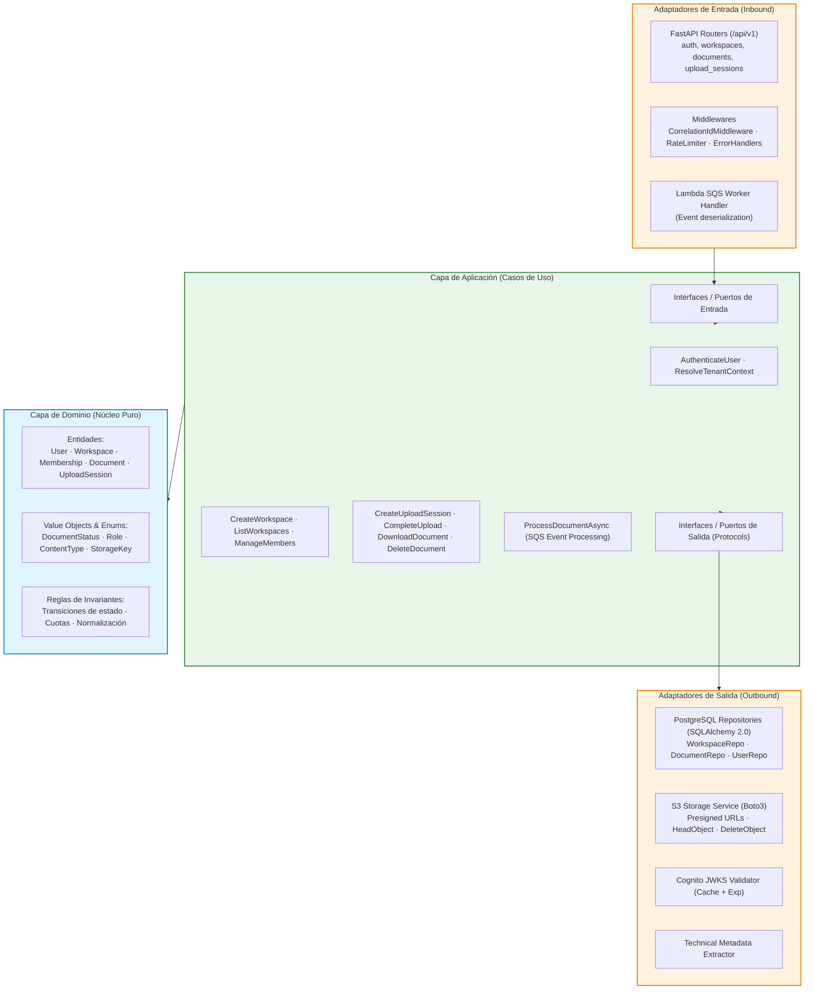
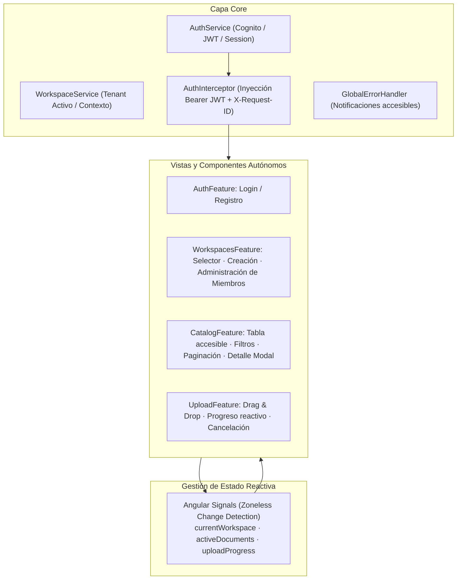

# Arquitectura del Sistema — Cloud Document Manager (CDM)

> **Documento de Arquitectura de Alto Nivel**  
> **Versión:** 1.0 (MVP 0.1)  
> **Cumplimiento:** *AGENTS.md* (§1, §2, §5, §6, §8, §9, §12, §13, §14) · ADR-0001 a ADR-0008  

---

## 1. Visión General del Sistema

**Cloud Document Manager (CDM)** es una plataforma SaaS multi-tenant diseñada para el almacenamiento seguro, catalogación, procesamiento asíncrono y gestión de documentos corporativos en la nube.

La arquitectura garantiza:
1. **Aislamiento Multi-Tenant Estricto:** Particionamiento lógico en PostgreSQL mediante `workspace_id` indexado en todas las tablas operativas y particionamiento físico/lógico en Amazon S3 bajo prefijos seguros `workspaces/{workspace_id}/documents/{document_id}/...`.
2. **Carga Directa Optimizada:** La carga binaria se efectúa directamente desde el navegador (Angular SPA) hacia Amazon S3 mediante URLs prefirmadas de vida corta (15 minutos), evitando que los archivos saturen el backend o atraviesen API Gateway.
3. **Procesamiento Asíncrono Desacoplado:** Una vez confirmado el archivo, eventos de S3 (`s3:ObjectCreated:*`) son canalizados a través de Amazon SQS hacia una función AWS Lambda Worker con reintentos controlados y Dead Letter Queue (DLQ).
4. **Cero Costes Ocultos y Mínimo Privilegio:** Uso exclusivo de servicios Serverless (Lambda, API Gateway HTTP v2, S3, SQS, Cognito, CloudWatch), eliminando costes continuos como NAT Gateways o balanceadores dedicados (*AGENTS.md* §13).

---

## 2. Diagrama de Arquitectura Global (End-to-End)



---

## 3. Arquitectura del Backend (Hexagonal / Ports & Adapters)

El backend en Python 3.12 implementa estrictamente Arquitectura Hexagonal (*AGENTS.md* §2, §8):



### Reglas de Dependencia
1. **El Dominio es completamente agnóstico:** Cero dependencias externas (`fastapi`, `sqlalchemy`, `pydantic`, `boto3`). Solo tipos estándar de Python (`dataclasses`, `enum`, `uuid`, `datetime`).
2. **Los Casos de Uso definen puertos:** Mediante `typing.Protocol`, desacoplándose de las implementaciones concretas de base de datos o almacenamiento en la nube.
3. **Persistencia aislada:** Los repositorios mapean modelos ORM a entidades de dominio inmutables antes de retornar hacia la aplicación.

---

## 4. Arquitectura del Frontend (Angular 22 Zoneless)

El cliente web está construido con Angular 22 bajo los lineamientos de accesibilidad WCAG AA y modularidad por características (*AGENTS.md* §9):



### Características Clave:
- **Signals Zoneless:** Operación sin `zone.js` (`provideZonelessChangeDetection()`), optimizando rendimiento, consumo de memoria y bundles compactos.
- **Validación Temprana y Accesible:** Validación previa en el navegador de tamaños y tipos MIME permitidos (PDF, PNG, JPEG, WEBP, TXT, CSV) antes de solicitar URLs prefirmadas.
- **Cero Lógica de Autorización Confiable en Cliente:** Las restricciones visuales mejoran la experiencia de usuario (UX), pero el backend valida de forma independiente e incondicional cada solicitud.

---

## 5. Matriz de Datos y Particionamiento Multi-Tenant

| Entidad | Clave Primaria (PK) | Tenant Isolation Key | Restricciones e Índices |
|---|---|---|---|
| `users` | `id` (UUID) | Global (N/A) | `cognito_sub` (UNIQUE), `email` |
| `workspaces` | `id` (UUID) | `id` | `slug` (UNIQUE), `created_by` (FK) |
| `workspace_memberships` | `id` (UUID) | `workspace_id` (FK) | `UNIQUE(workspace_id, user_id)`, `role`, `status` |
| `documents` | `id` (UUID) | `workspace_id` (FK) | INDEX en `(workspace_id, deleted_at, created_at)` |
| `upload_sessions` | `id` (UUID) | `workspace_id` (FK) | `expires_at`, `status`, `storage_key` |

### Particionamiento en S3:
```text
s3://<bucket-name>/
  └── workspaces/
      └── {workspace_id}/
          └── documents/
              └── {document_id}/
                  └── {sanitized_filename}
```
Ningún documento puede ser referenciado sin verificar que la membresía del usuario autenticado corresponda al `workspace_id` de la ruta.

---

## 6. Pipeline de Despliegue e Infraestructura como Código (IaC)

La infraestructura está declarada mediante módulos reutilizables de Terraform en `infrastructure/terraform/`:
- `modules/cognito`: User Pool, App Client y grupos de roles.
- `modules/s3-storage`: Bucket de documentos con bloqueo público, KMS/AES256, CORS y notificaciones de eventos S3.
- `modules/sqs-worker-queue`: Cola SQS de eventos, Dead Letter Queue (DLQ) y alarmas de mensajes visibles.
- `modules/lambda-api`: Función Lambda para FastAPI, integración con API Gateway HTTP v2 y roles IAM least-privilege.
- `modules/lambda-worker`: Función Lambda asíncrona disparada por SQS con políticas IAM de lectura/escritura acotadas.
- `modules/observability-cloudwatch`: Tópico SNS y alarmas CloudWatch para errores Lambda, throttles y mensajes encolados en DLQ.

Entornos independientes:
- `infrastructure/terraform/environments/dev`: Entorno de desarrollo / staging con costes bajo control.
