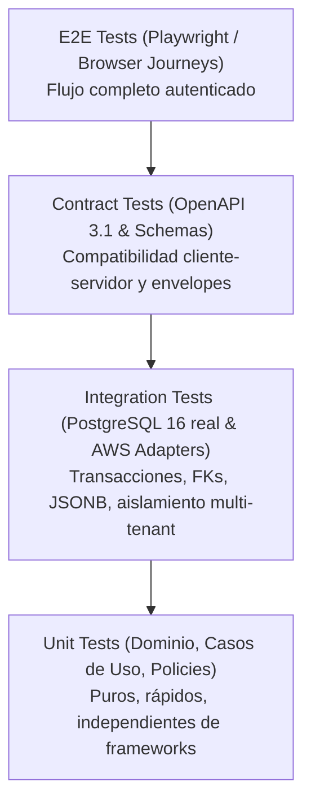

# Estrategia de Pruebas y Pirámide de Calidad — Cloud Document Manager (CDM)

> **Documento de arquitectura y calidad (CDM-49 / AGENTS.md §15)**  
> Define la pirámide de pruebas, límites de capas arquitectónicas, políticas de emulación, seguridad de red y criterios de automatización en CI/CD.

---

## 1. Pirámide de Pruebas



### Distribución de Responsabilidades

| Nivel | Alcance | Tecnologías | Dependencias Externas |
|---|---|---|---|
| **Unit Tests** | Dominio puro, invariantes, casos de uso, transformaciones | `pytest`, `vitest` | Ninguna (dobles de puertos en memoria) |
| **Integration Tests** | Repositorios SQLAlchemy, migraciones Alembic, adaptadores S3/Cognito | `pytest`, PostgreSQL 16 (Docker) | PostgreSQL real local/CI (sin SQLite en integración, ADR-0003) |
| **Contract Tests** | Especificación OpenAPI 3.1, envelopes de error, serialización DTOs | `TestClient`, `FastAPI`, `Pydantic` | Ninguna |
| **E2E Tests** | Flujos completos desde la UI Angular hasta la API | `Playwright` / `Angular Test Harnesses` | Entorno de prueba aislado |

---

## 2. Principios y Reglas Innegociables

1. **Aislamiento Multi-Tenant Verificado:**
   Toda prueba de persistencia o caso de uso que involucre documentos debe validar que un `workspace_id` ajeno no puede leer, listar ni mutar entidades de otro tenant (prevención de vulnerabilidades IDOR/BOLA).
2. **PostgreSQL Real en Integración (ADR-0003):**
   Las pruebas de integración de base de datos se ejecutan contra PostgreSQL 16 idéntico al de producción (usando el service container en CI o Docker Compose en local). Nunca se utiliza SQLite para integración ya que enmascara diferencias en tipos UUID nativos, funciones de fecha con timezone, JSONB e índices.
3. **Rollback Transaccional Automático:**
   Cada prueba de integración en `tests/integration/` corre dentro de una transacción que se revierte (`rollback()`) al finalizar. Ninguna prueba deja datos residuales ni contamina el estado para las siguientes.
4. **Protección Anti-Leak de Red (Zero Accidental Cloud Calls):**
   El archivo `conftest.py` instala un guard de sockets a nivel de proceso (`guard_against_external_network_calls`) que intercepta cualquier intento de llamada saliente TCP que no apunte a `127.0.0.1` o `localhost`. Si el código intentase llamar a `s3.amazonaws.com` o `cognito-idp.amazonaws.com`, la prueba falla de inmediato con `RuntimeError`.
5. **Cero Credenciales en Código y Fixtures:**
   Las variables `AWS_ACCESS_KEY_ID`, `AWS_SECRET_ACCESS_KEY` y `AWS_SESSION_TOKEN` se configuran automáticamente con valores sintéticos de testing (`testing-mock-...`) garantizando que nunca se lean credenciales reales de la máquina anfitriona.

---

## 3. Estructura de la Suite Backend (`apps/api`)

```text
apps/api/tests/
├── conftest.py                          # Fixtures globales, guard de red, DB transaccional y fábricas
├── unit/                                # Pruebas unitarias puras (dominio y casos de uso)
│   ├── test_document_domain.py          # Invariantes y transiciones de estado de documentos
│   ├── test_workspace_domain.py         # Jerarquía de roles ADR-0001 e invariantes de tenant
│   ├── test_complete_upload.py          # Caso de uso de confirmación e inspección
│   ├── test_download_url.py              # Caso de uso de emisión de URLs temporales
│   ├── test_file_policy.py              # Allowlist MIME, extensiones y límites de tamaño
│   └── test_retry_processing.py         # Manejo de reintentos idempotentes y DLQ
├── integration/                         # Pruebas contra PostgreSQL y adaptadores AWS
│   ├── test_database.py                 # Conectividad y validación de versión Alembic
│   ├── test_postgres_repositories.py    # CRUD, FKs, JSONB, ILIKE y aislamiento multi-tenant
│   └── test_aws_adapters.py             # S3 presigned URLs, Content-Disposition RFC 6266 y guards
└── contract/                            # Pruebas de contrato HTTP y OpenAPI
    ├── test_health.py                   # Endpoint de salud y verificación anti-fuga de configuración
    ├── test_error_envelope.py           # Envelope estándar de errores (docs/api/standards.md)
    ├── test_openapi_schema.py           # Validación OpenAPI 3.1.0 y rutas canónicas
    └── test_document_contract_schemas.py# Serialización de DTOs y envelopes de respuesta
```

---

## 4. Pipeline de Integración Continua (GitHub Actions)

El workflow `.github/workflows/ci.yml` ejecuta de forma paralela y determinista las puertas de calidad:

1. **Job Backend:**
   - Levanta servicio `postgres:16-alpine` en localhost:5432 con health checks.
   - Aplica migraciones con `uv run alembic upgrade head`.
   - Ejecuta linter y formato: `uv run ruff check .` y `uv run ruff format --check .`.
   - Ejecuta análisis estático de tipos: `uv run mypy`.
   - Corre la suite completa: `uv run pytest`.
2. **Job Frontend:**
   - Instala dependencias con `pnpm install --frozen-lockfile`.
   - Verifica compilación de producción: `pnpm exec ng build`.
   - Ejecuta linter de templates y accesibilidad: `pnpm exec ng lint`.
   - Ejecuta suite unitaria en Vitest: `pnpm exec ng test --no-watch`.
3. **Job Infra:**
   - Valida formato y sintaxis de Terraform: `terraform fmt -check` y `terraform validate`.

Cualquier regresión o fallo en los criterios bloquea la integración en las ramas protegidas (`develop`, `main`).
