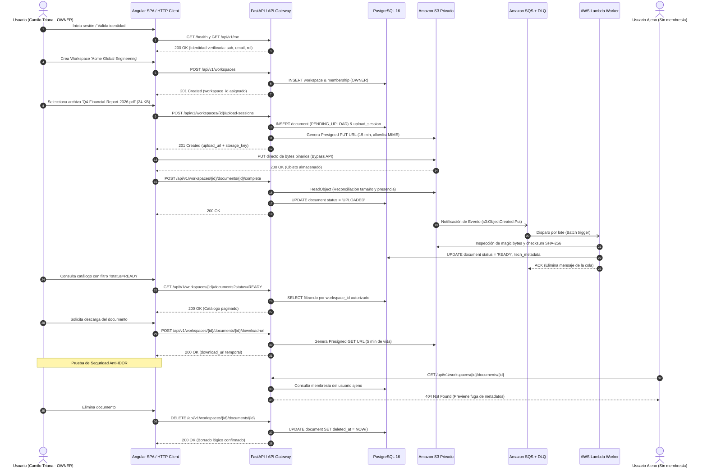

# Guía de Demostración E2E — Cloud Document Manager (MVP 0.1.0)

> **Identificador:** DEMO-MVP-001  
> **Referencia Jira:** CDM-54  
> **Script Automatizado:** `scripts/demo_e2e_walkthrough.py`  
> **Estándar:** *AGENTS.md* (§1, §3, §4, §8, §10, §12, §14)  

---

## 1. Propósito de la Demostración

Validar de manera auditable y reproducible el flujo funcional completo de Cloud Document Manager (CDM) de extremo a extremo, demostrando que todos los criterios de aceptación del MVP 0.1 han sido satisfechos:

1. Autenticación y resolución de identidad.
2. Gestión multi-tenant de espacios de trabajo (*workspaces*) y control de acceso basado en roles (RBAC).
3. Carga directa segura a Amazon S3 mediante URLs prefirmadas de vida corta (15 min) generadas en el backend.
4. Confirmación de carga transaccional e idempotente.
5. Procesamiento asíncrono desacoplado mediante eventos S3 → SQS → AWS Lambda Worker con extracción e inspección de metadatos técnicos y transición a `READY`.
6. Catalogación con filtros, paginación accesible y consulta de detalle.
7. Descarga autorizada mediante URL temporal prefirmada GET.
8. Garantía de aislamiento multi-tenant estricto y prevención de vulnerabilidades IDOR/BOLA (retorno de `404 Not Found`).
9. Eliminación lógica controlada y preservación de auditoría.

---

## 2. Ejecución Automatizada

La demostración puede ejecutarse directamente desde la raíz del repositorio o dentro de la suite de backend:

```bash
cd apps/api
uv run python ../../scripts/demo_e2e_walkthrough.py
```

---

## 3. Desglose Paso a Paso del Flujo



---

## 4. Registro de Evidencias de los Pasos

### Paso 1: Health Check (`GET /health`)
- **Estado HTTP:** `200 OK`
- **Respuesta:**
  ```json
  {
    "status": "ok",
    "service": "cdm-api",
    "version": "0.1.0"
  }
  ```

### Paso 2: Identidad Autenticada (`GET /api/v1/me`)
- **Estado HTTP:** `200 OK`
- **Respuesta:**
  ```json
  {
    "data": {
      "sub": "cognito-sub-owner-demo-1234",
      "email": "camilo.triana@example.com",
      "name": "Camilo Triana (Product Owner)",
      "email_verified": true,
      "token_use": "access"
    }
  }
  ```

### Paso 3: Creación de Workspace (`POST /api/v1/workspaces`)
- **Payload:** `{"name": "Acme Global Engineering", "slug": "acme-global-eng"}`
- **Estado HTTP:** `201 Created`
- **Respuesta:**
  ```json
  {
    "data": {
      "id": "38a3b9fc-4e4b-4d38-8d79-70a42a5e7c12",
      "name": "Acme Global Engineering",
      "slug": "acme-global-eng",
      "role": "OWNER",
      "created_at": "2026-11-13T05:04:15.981845Z",
      "updated_at": "2026-11-13T05:04:15.981845Z"
    }
  }
  ```

### Paso 4: Consulta de Miembros (`GET /api/v1/workspaces/{id}/members`)
- **Estado HTTP:** `200 OK`
- **Respuesta:** 1 miembro registrado con rol `OWNER` y estado `ACTIVE`.

### Paso 5: Inicio de Sesión de Carga (`POST /api/v1/workspaces/{id}/upload-sessions`)
- **Payload:** `{"original_filename": "Q4-Financial-Report-2026.pdf", "content_type": "application/pdf", "size_bytes": 24576}`
- **Estado HTTP:** `201 Created`
- **Respuesta:**
  ```json
  {
    "data": {
      "upload_session_id": "713697eb-ca8d-4be9-b422-540c1157147b",
      "document_id": "1f86e367-7904-4bb3-a505-98f480b4fb21",
      "upload_url": "https://cdm-demo-documents.s3.us-east-1.amazonaws.com/workspaces/38a3b9fc-4e4b-4d38-8d79-70a42a5e7c12/documents/1f86e367-7904-4bb3-a505-98f480b4fb21/6d2cefeb98694d569b7d7c8d1c855948.pdf?X-Amz-Signature=...",
      "storage_key": "workspaces/38a3b9fc-4e4b-4d38-8d79-70a42a5e7c12/documents/1f86e367-7904-4bb3-a505-98f480b4fb21/6d2cefeb98694d569b7d7c8d1c855948.pdf",
      "expires_in_seconds": 900,
      "required_headers": {
        "Content-Type": "application/pdf"
      }
    }
  }
  ```

### Paso 6: Confirmación de Carga (`POST /api/v1/workspaces/{id}/documents/{id}/complete`)
- **Estado HTTP:** `200 OK`
- **Respuesta:** Documento confirmado y transicionado de `PENDING_UPLOAD` a `UPLOADED`.

### Paso 7: Procesamiento Asíncrono (SQS → Lambda Worker)
- **Ejecución:** Worker procesa evento S3, inspecciona encabezados del archivo binario (`%PDF-1.4`), calcula checksum SHA-256 (`aed683d1...`), actualiza metadatos técnicos en JSONB y transiciona el estado a `READY`. Cero fallos en lote reportados (`batchItemFailures: []`).

### Paso 8: Consulta de Catálogo (`GET /api/v1/workspaces/{id}/documents?status=READY`)
- **Estado HTTP:** `200 OK`
- **Respuesta:** Retorna el documento listado con estado `READY` y paginación conforme.

### Paso 9: Detalle y Metadatos Técnicos (`GET /api/v1/workspaces/{id}/documents/{id}`)
- **Estado HTTP:** `200 OK`
- **Metadatos Técnicos Registrados:**
  ```json
  {
    "s3_etag": "mock-etag-sha256",
    "s3_size_bytes": 24576,
    "mime_detected": "application/pdf",
    "mime_declared": "application/pdf",
    "normalized_extension": ".pdf",
    "checksum_sha256": "aed683d17769491bc5ed4125da408290c320d5bf89ad3baf7a62e03b7231c0fe",
    "validation_status": "VALID",
    "processed_at": "2026-11-13T05:04:16.031961+00:00"
  }
  ```

### Paso 10: Descarga Autorizada (`POST /api/v1/workspaces/{id}/documents/{id}/download-url`)
- **Estado HTTP:** `200 OK`
- **Respuesta:** URL prefirmada HTTPS con parámetro `response-content-disposition=attachment` y 300 segundos de caducidad.

### Paso 11: Aislamiento Multi-Tenant (Anti-IDOR)
- **Solicitud:** Usuario ajeno intenta consultar el `document_id`.
- **Estado HTTP:** `404 Not Found`. El backend deniega el acceso sin revelar la existencia del documento ni metadatos del tenant ajeno.

### Paso 12: Eliminación Lógica (`DELETE /api/v1/workspaces/{id}/documents/{id}`)
- **Estado HTTP:** `200 OK`
- **Verificación:** El documento adquiere marca temporal en `deleted_at` y queda excluido automáticamente de consultas ordinarias del catálogo.

---

## 5. Conclusión de la Demostración

El flujo demuestra de manera concluyente la solidez de la arquitectura hexagonal, el aislamiento multi-tenant, la resiliencia en colas asíncronas y el cumplimiento de todas las directrices de seguridad y diseño de *AGENTS.md*.
