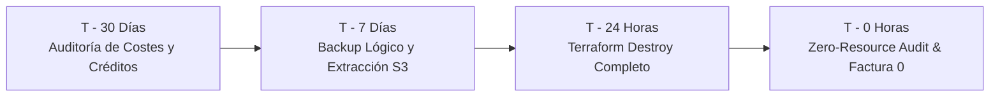

# Runbook: Teardown en AWS, Validación de Cero Recursos y Checklist de Salida

> **Identificador:** RB-TEARDOWN-001  
> **Ámbito:** Infraestructura AWS y Gestión Financiera / Cloud Document Manager (CDM)  
> **Criterios de Aceptación:** CDM-53 · *AGENTS.md* (§13) · ADR-0007  
> **Última Actualización:** 2026-11-12  

---

## 1. Justificación y Directrices de Protección Financiera

> [!CAUTION]
> **RESTRICCIONES FINANCIERAS ESTRICTAS (*AGENTS.md* §13):**
> 1. Toda infraestructura aprovisionada en AWS para pruebas o demostración debe ser completamente desmontada cuando no esté en uso activo.
> 2. No se asume que apagar una función o eliminar una pila destruye automáticamente todos los elementos facturables. Los datos remanentes en S3, volúmenes EBS huérfanos o grupos de CloudWatch Logs generan cobros acumulativos continuos.
> 3. Ningún comando `terraform destroy` o vaciado masivo de recursos debe ejecutarse sin autorización expresa y respaldo previo de la información crítica.

---

## 2. Protocolo de Destrucción Controlada (Terraform Teardown)

El proceso de teardown debe seguir un orden secuencial riguroso para evitar bloqueos por dependencias circulares o restricciones de AWS.

### 2.1 Paso Previo Obligatorio: Vaciado del Bucket S3
AWS prohíbe la eliminación de buckets S3 que contengan objetos. Si el bucket no se vacía antes de ejecutar Terraform, el comando fallará:

```bash
# 1. Identificar el nombre exacto del bucket de documentos
BUCKET_NAME=$(cd infrastructure/terraform/environments/dev && terraform output -raw documents_bucket_name 2>/dev/null || echo "cdm-dev-documents-<ID>")

# 2. Eliminar recursivamente todos los objetos y prefijos
echo "Vaciando bucket S3: ${BUCKET_NAME}"
aws s3 rm "s3://${BUCKET_NAME}" --recursive

# 3. En caso de que el versionado estuviera habilitado, eliminar versiones y Delete Markers:
aws s3api delete-objects \
  --bucket "${BUCKET_NAME}" \
  --delete "$(aws s3api list-object-versions \
                --bucket "${BUCKET_NAME}" \
                --query='{Objects: Versions[].{Key:Key,VersionId:VersionId}}' \
                --output json)" 2>/dev/null || true

aws s3api delete-objects \
  --bucket "${BUCKET_NAME}" \
  --delete "$(aws s3api list-object-versions \
                --bucket "${BUCKET_NAME}" \
                --query='{Objects: DeleteMarkers[].{Key:Key,VersionId:VersionId}}' \
                --output json)" 2>/dev/null || true
```

### 2.2 Planificación y Ejecución de `terraform destroy`
Accede al directorio del entorno `dev`:

```bash
cd infrastructure/terraform/environments/dev

# 1. Generar plan explícito de destrucción
terraform plan -destroy -out=destroy.plan

# 2. Revisar detenidamente los recursos marcados para eliminación:
#    - API Gateway HTTP v2
#    - Funciones Lambda (cdm-dev-api, cdm-dev-worker)
#    - Colas SQS y Dead Letter Queue
#    - Cognito User Pool y Client
#    - Tópico SNS y Alarmas CloudWatch
#    - Bucket S3 de documentos

# 3. Aplicar destrucción con autorización expresa
terraform apply destroy.plan
```

---

## 3. Verificación Manual de Cero Recursos (Zero-Resource Audit)

Una vez completado el teardown de Terraform, es obligatorio auditar la cuenta de AWS mediante el CLI para certificar que no existan recursos residuales o cobros silenciosos (*AGENTS.md* §13):

### 3.1 Almacenamiento (Amazon S3)
Verificar que ningún bucket asociado a CDM permanezca activo:
```bash
aws s3 ls | grep cdm
```
*Resultado esperado:* Salida vacía.

### 3.2 Computación Serverless (AWS Lambda y API Gateway)
```bash
# 1. Funciones Lambda
aws lambda list-functions \
  --query "Functions[?starts_with(FunctionName, 'cdm-')].FunctionName" \
  --output table

# 2. APIs HTTP
aws apigatewayv2 get-apis \
  --query "Items[?starts_with(Name, 'cdm-')].[Name, ApiId]" \
  --output table
```
*Resultado esperado:* Listas vacías `[]`.

### 3.3 Mensajería (Amazon SQS y SNS)
```bash
# 1. Colas SQS
aws sqs list-queues \
  --queue-name-prefix "cdm-" \
  --output table

# 2. Tópicos SNS
aws sns list-topics \
  --query "Topics[?contains(TopicArn, 'cdm-')].TopicArn" \
  --output table
```
*Resultado esperado:* Ninguna cola ni tópico retornado.

### 3.4 Identidad (Amazon Cognito)
```bash
aws cognito-idp list-user-pools --max-results 20 \
  --query "UserPools[?starts_with(Name, 'cdm-')].[Name, Id]" \
  --output table
```
*Resultado esperado:* Ningún User Pool asociado a CDM.

### 3.5 Observabilidad (CloudWatch Logs & Alarms)
Asegurar que los log groups no acumulen datos facturables por retención indefinida:
```bash
# 1. Grupos de logs
aws logs describe-log-groups \
  --log-group-name-prefix "/aws/lambda/cdm-" \
  --query "logGroups[].logGroupName" \
  --output table

# Si existen log groups huérfanos, eliminarlos manualmente:
# aws logs delete-log-group --log-group-name "/aws/lambda/cdm-dev-api"

# 2. Alarmas CloudWatch
aws cloudwatch describe-alarms \
  --alarm-name-prefix "cdm-" \
  --query "MetricAlarms[].AlarmName" \
  --output table
```
*Resultado esperado:* Listas vacías.

### 3.6 Auditoría de Recursos de Alto Coste (Verificación Estricta)
Asegurar que jamás hayan sido creados recursos prohibidos o con costes continuos:
```bash
# 1. NAT Gateways (Costo continuo elevado: PROHIBIDO)
aws ec2 describe-nat-gateways \
  --filter "Name=state,Values=available,pending" \
  --query "NatGateways[].[NatGatewayId, State]" \
  --output table

# 2. Elastic IPs no asignadas (Cobro por hora de inactividad)
aws ec2 describe-addresses \
  --query "Addresses[?AssociationId==null].[PublicIp, AllocationId]" \
  --output table

# 3. Instancias o Snapshots de RDS retenidos
aws rds describe-db-instances \
  --query "DBInstances[?starts_with(DBInstanceIdentifier, 'cdm-')].DBInstanceIdentifier" \
  --output table
```
*Resultado esperado:* Cero recursos en todas las consultas.

---

## 4. Checklist de Exportación Previo a la Expiración del Plan AWS

Cuando la cuenta de prueba, créditos o capa gratuita (*Free Tier*) de AWS se acerque a su fin, ejecutar el siguiente cronograma de salida:



### 4.1 T - 30 Días: Auditoría de Fechas y Créditos
- [ ] Verificar fecha exacta de expiración en **AWS Billing and Cost Management Console**.
- [ ] Comprobar saldo restante de créditos promocionales.
- [ ] Ejecutar reporte de costes con AWS CLI:
  ```bash
  aws ce get-cost-and-usage \
    --time-period Start=$(date -d "30 days ago" +%Y-%m-%d),End=$(date +%Y-%m-%d) \
    --granularity MONTHLY \
    --metrics "UnblendedCost"
  ```

### 4.2 T - 7 Días: Respaldo y Extracción de Datos
- [ ] **Generar dump final de PostgreSQL:** Seguir `docs/runbooks/backup-restore.md` y transferir el archivo `.dump` a almacenamiento local seguro o disco cifrado.
- [ ] **Descargar patrimonio documental de S3:**
  ```bash
  mkdir -p ./exported_documents
  aws s3 sync "s3://${BUCKET_NAME}" ./exported_documents/
  ```
- [ ] **Exportar métricas históricas de CloudWatch:** Descargar logs de auditoría si se requieren para cumplimiento normativo.

### 4.3 T - 24 Horas: Destrucción Total de Infraestructura
- [ ] Notificar a los usuarios o colaboradores el fin de la ventana de pruebas en la nube.
- [ ] Vaciar completamente los buckets S3.
- [ ] Ejecutar `terraform destroy` en `infrastructure/terraform/environments/dev`.
- [ ] Eliminar cualquier archivo `.tfstate` local que contenga referencias obsoletas si ya no se utilizará.

### 4.4 T - 0 Horas: Certificación de Facturación Cero
- [ ] Ejecutar la batería de comandos de la **Sección 3 (Zero-Resource Audit)**.
- [ ] Confirmar que **Forecasted Monthly Spend** en AWS Cost Explorer sea `$0.00`.
- [ ] Cerrar o pausar la cuenta de AWS si no se requiere para otros proyectos.
