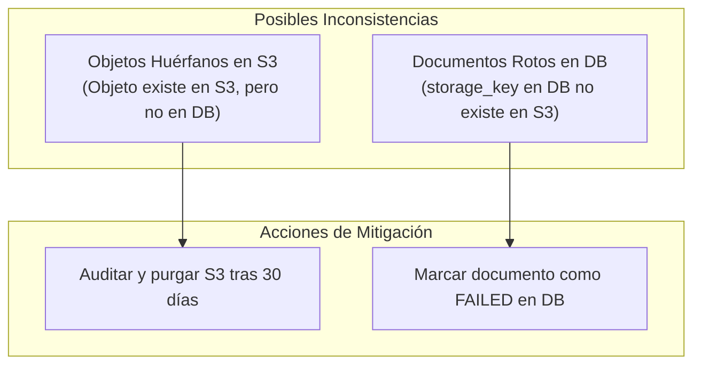

# Runbook: Backup, Restauración de PostgreSQL y Reconciliación con S3

> **Identificador:** RB-DATA-001  
> **Ámbito:** Persistencia y Almacenamiento de Archivos / Cloud Document Manager (CDM)  
> **Criterios de Aceptación:** CDM-53 · *AGENTS.md* (§1, §2, §10, §12, §13)  
> **Última Actualización:** 2026-11-12  

---

## 1. Objetivos de Recuperación y Estrategia

| Parámetro | Objetivo | Justificación |
|---|---|---|
| **RPO (Recovery Point Objective)** | <= 24 horas (MVP) | Backups lógicos diarios programados. |
| **RTO (Recovery Time Objective)** | <= 2 horas | Restauración automatizada mediante `pg_restore` y verificación de integridad. |
| **Consistencia Híbrida** | DB + S3 | La verdad transaccional de metadatos reside en PostgreSQL; el contenido binario reside en S3. |

---

## 2. Procedimiento de Backup Lógico (PostgreSQL)

El respaldo se realiza mediante `pg_dump` utilizando el formato personalizado binario (`-Fc`), el cual ofrece compresión nativa, verificación de integridad y flexibilidad de restauración selectiva.

### 2.1 Backup en Entorno Local (Docker Compose)
Ejecutar desde la máquina host:

```bash
# 1. Definir variables y timestamp
TIMESTAMP=$(date +%Y%m%d_%H%M%S)
BACKUP_DIR="./backups"
mkdir -p "$BACKUP_DIR"

# 2. Ejecutar dump dentro del contenedor oficial de PostgreSQL
docker compose exec -T db pg_dump \
  -U cdm_user \
  -d cdm_dev \
  -Fc \
  -f "/tmp/cdm_backup_${TIMESTAMP}.dump"

# 3. Copiar el archivo generado al host
docker compose cp db:/tmp/cdm_backup_${TIMESTAMP}.dump "${BACKUP_DIR}/cdm_backup_${TIMESTAMP}.dump"

# 4. Limpiar archivo temporal en el contenedor
docker compose exec -T db rm "/tmp/cdm_backup_${TIMESTAMP}.dump"

echo "Backup completado exitosamente: ${BACKUP_DIR}/cdm_backup_${TIMESTAMP}.dump"
```

### 2.2 Backup en AWS RDS PostgreSQL
Para instancias RDS en AWS, ejecutar desde un bastion o entorno seguro con conectividad a la VPC:

```bash
TIMESTAMP=$(date +%Y%m%d_%H%M%S)

PGPASSWORD="${DB_PASSWORD}" pg_dump \
  -h "${DB_HOST}" \
  -p "${DB_PORT:-5432}" \
  -U "${DB_USER}" \
  -d "${DB_NAME}" \
  -Fc \
  -f "cdm_rds_backup_${TIMESTAMP}.dump"
```

### 2.3 Validación de la Integridad del Archivo de Backup
Antes de almacenar o rotar la copia, verificar que el archivo no esté corrupto listando su tabla de contenidos:

```bash
pg_restore -l "cdm_backup_${TIMESTAMP}.dump" | head -n 30
```
Si el comando lista los esquemas, tablas y triggers sin errores, el dump es íntegro.

---

## 3. Procedimiento de Restauración (Restore)

> [!CAUTION]
> **ADVERTENCIA DE SOBREESCRITURA:** La restauración sobreescribe el estado actual de la base de datos. Detener previamente las instancias de Lambda API y Worker para evitar escrituras concurrentes durante el proceso.

### 3.1 Restauración en Entorno Local (Docker)
```bash
BACKUP_FILE="./backups/cdm_backup_YYYYMMDD_HHMMSS.dump"

# 1. Copiar el backup al contenedor
docker compose cp "$BACKUP_FILE" db:/tmp/restore_target.dump

# 2. Restaurar esquema y datos limpiando objetos existentes
docker compose exec -T db pg_restore \
  -U cdm_user \
  -d cdm_dev \
  -c \
  --if-exists \
  --no-owner \
  /tmp/restore_target.dump

# 3. Sincronizar migraciones Alembic (asegurar compatibilidad con la versión actual de código)
cd apps/api
uv run alembic upgrade head
```

### 3.2 Restauración en AWS RDS
```bash
PGPASSWORD="${DB_PASSWORD}" pg_restore \
  -h "${DB_HOST}" \
  -p "${DB_PORT:-5432}" \
  -U "${DB_USER}" \
  -d "${DB_NAME}" \
  -c \
  --if-exists \
  --no-owner \
  "cdm_rds_backup_YYYYMMDD_HHMMSS.dump"

# Ejecutar migraciones
cd apps/api
DATABASE_URL="postgresql+psycopg://..." uv run alembic upgrade head
```

### 3.3 Verificación de Integridad Post-Restauración
Ejecutar la siguiente consulta SQL para verificar la coherencia de datos por workspace:

```sql
SELECT 
    w.id AS workspace_id,
    w.name AS workspace_name,
    COUNT(DISTINCT m.user_id) AS total_members,
    COUNT(DISTINCT d.id) AS total_documents,
    COUNT(DISTINCT CASE WHEN d.deleted_at IS NULL THEN d.id END) AS active_documents
FROM workspaces w
LEFT JOIN workspace_memberships m ON w.id = m.workspace_id
LEFT JOIN documents d ON w.id = d.workspace_id
GROUP BY w.id, w.name;
```

---

## 4. Reconciliación y Consistencia entre PostgreSQL y Amazon S3

Debido a que el almacenamiento de metadatos (DB) y el binario (S3) están físicamente desacoplados, una restauración de base de datos a un punto anterior en el tiempo puede generar inconsistencias:



### 4.1 Detección de Inconsistencias (Script de Reconciliación)
Procedimiento para auditar un workspace específico:

1. **Obtener lista de claves activas desde PostgreSQL:**
   ```sql
   SELECT storage_key FROM documents 
   WHERE workspace_id = '<WORKSPACE_UUID>' AND deleted_at IS NULL;
   ```
2. **Obtener lista de objetos reales en S3:**
   ```bash
   aws s3api list-objects-v2 \
     --bucket "<BUCKET_NAME>" \
     --prefix "workspaces/<WORKSPACE_UUID>/documents/" \
     --query "Contents[].Key" \
     --output text
   ```
3. **Cruzamiento y Reconciliación:**
   - Si una clave está en S3 pero ausente en DB: clasificar como objeto huérfano.
   - Si una clave está en DB pero ausente en S3: marcar el documento con `status = 'FAILED'` y registrar en `technical_metadata` la causa: `"s3_object_missing_post_restore"`.

---

## 5. Ciclo de Vida y Limpieza Controlada en Amazon S3

Para prevenir acumulación de archivos innecesarios y controlar costes de almacenamiento (*AGENTS.md* §12, §13):

### 5.1 Regla de Ciclo de Vida para Cargas Incompletas
Aprovisionada en `infrastructure/terraform/modules/s3-storage/main.tf`:
- **AbortIncompleteMultipartUpload:** 7 días. Si una carga multipart iniciada por el cliente se interrumpe, AWS cancela y purga los fragmentos automáticamente.

### 5.2 Limpieza de Sesiones de Carga Expiradas
Las sesiones en la tabla `upload_sessions` que expiren (`expires_at < NOW()`) sin haber completado la confirmación (`status = 'PENDING'`) deben limpiarse periódicamente.
- **Consulta de Purga Transaccional:**
  ```sql
  DELETE FROM upload_sessions
  WHERE status = 'PENDING' AND expires_at < NOW() - INTERVAL '7 days';
  ```

### 5.3 Purga Física de Documentos con Borrado Lógico
El producto implementa borrado lógico (`deleted_at IS NOT NULL`). Tras un período de retención legal/operativo de 30 días, los objetos marcados pueden ser eliminados físicamente de S3:
1. Identificar claves candidatas:
   ```sql
   SELECT id, workspace_id, storage_key FROM documents
   WHERE deleted_at IS NOT NULL AND deleted_at < NOW() - INTERVAL '30 days';
   ```
2. Eliminar objeto físico en S3 con `DeleteObject`.
3. Actualizar registro en base de datos o trasladar a tabla histórica de auditoría.
