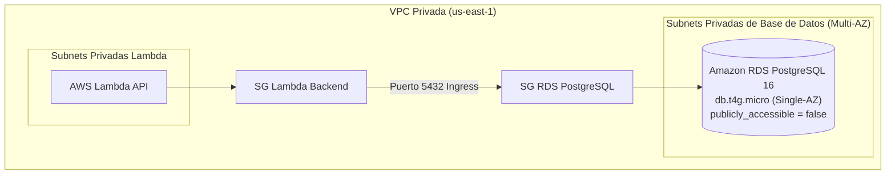

# Runbook: Evaluación de Costes, Red y Arquitectura de RDS PostgreSQL

> **Contexto:** Tarea `CDM-21` / Subtareas `CDM-75` y `CDM-76`.  
> **Referencias:** [ADR-0008: PostgreSQL Local vs RDS Administrado](../adr/0008-postgres-local-vs-rds.md) | [Auditoría AWS Free Plan](aws-account-audit.md) | [AGENTS.md](../../AGENTS.md)

---

## 1. Validación de Elegibilidad y Análisis Financiero (CDM-75)

### 1.1 Estado de la Cuenta
- **Tipo de plan:** AWS Free Plan (cuenta abierta en noviembre de 2026, vigencia 182 días hasta el 12 de mayo de 2027).
- **Saldo de créditos disponible:** \$100.00 USD.
- **Región operativa:** `us-east-1` (N. Virginia), según [ADR-0007](../adr/0007-region-aws.md).

### 1.2 Análisis de Disponibilidad en el Free Plan
- RDS **no** forma parte del nivel *Always Free* (Siempre Gratis) en AWS.
- En cuentas nuevas con Free Tier anterior existía una cuota de 750 horas de `db.t2.micro`/`db.t3.micro` durante 12 meses. Sin embargo, en el modelo **AWS Free Plan con créditos cerrados (\$100 USD)**, cualquier consumo de computación y almacenamiento de RDS se descuenta directamente de la bolsa de créditos.

### 1.3 Estimación de Coste Mensual (`us-east-1`)
Para la configuración mínima recomendada para desarrollo/pruebas:
- **Clase de instancia:** `db.t4g.micro` (AWS Graviton2, 2 vCPUs, 1 GiB de memoria RAM).
  - Tarifa: \$0.018 USD por hora.
  - Coste mensual (730 horas): **\$13.14 USD**.
- **Almacenamiento:** 20 GiB `gp3` (volumen mínimo admitido en RDS).
  - Tarifa: \$0.115 USD por GiB-mes.
  - Coste mensual: **\$2.30 USD**.
- **Backups automatizados:** 1 día de retención (gratuito dentro del tamaño del almacenamiento asignado si el snapshot no supera el tamaño de la BD).
- **Total estimado mensual:** **~\$15.44 USD / mes**.

### 1.4 Impacto en la Bolsa de Créditos
$$\$15.44 \times 6 \text{ meses} = \$92.64 \text{ USD}$$
Mantener una instancia RDS encendida las 24 horas durante el ciclo de vida del MVP consumiría **más del 92%** de todos los créditos de la cuenta, provocando la suspensión anticipada del entorno antes de terminar el proyecto.

### 1.5 Decisión Go / No-Go
- **Para desarrollo continuo y pruebas locales:** **NO-GO**. Se mantiene PostgreSQL 16 sobre Docker Compose (`compose.yaml`) a coste \$0.
- **Para Infraestructura como Código (IaC):** **GO**. Se diseña y parametriza el módulo Terraform `modules/rds-postgres` con la bandera de seguridad `enable_rds = false` por defecto.
- **Para demos o validaciones en la nube:** Se permite el aprovisionamiento efímero controlado (horas puntuales) con destrucción inmediata (`terraform destroy -target=module.rds_postgres`).

---

## 2. Arquitectura de Red sin NAT Gateway (CDM-76)

La regla rectora en [AGENTS.md](../../AGENTS.md) prohíbe explícitamente el uso de **NAT Gateway** debido a su coste fijo de \$0.045/hora (~~\$32 USD/mes~~).



### 2.1 Principios de Seguridad de Red
1. **Acceso Privado Exclusivo:** `publicly_accessible = false`. La base de datos no posee IP pública ni entrada desde Internet.
2. **Subnet Group Multi-AZ Requerido por AWS:** Aunque la instancia sea Single-AZ para ahorrar costes, AWS exige que el `aws_db_subnet_group` contenga subredes en al menos dos Availability Zones distintas (p. ej. `us-east-1a` y `us-east-1b`).
3. **Security Group Aislado:**
   - **Ingress:** Puerto `5432` restringido exclusivamente al Security Group del backend (`security_groups = [var.lambda_security_group_id]`).
   - **Egress:** Ninguno.
4. **Cero Salida a Internet:** La base de datos no requiere acceso saliente a Internet para parches ni repositorios, eliminando la necesidad de NAT Gateway.

---

## 3. Gestión Segura de Credenciales

1. **Generación:** Contraseña aleatoria generada mediante el proveedor Terraform `random_password` (24 caracteres, alfanumérico estricto sin caracteres problemáticos de URL).
2. **Almacenamiento:** Se persiste en **AWS Secrets Manager** (`aws_secretsmanager_secret`) o **AWS SSM Parameter Store** cifrado con KMS.
3. **Cero Secretos en Git:** Las variables de Terraform no contienen contraseñas hardcodeadas.

---

## 4. Ciclo de Vida y Procedimiento de Teardown Efímero

Cuando se requiera levantar la base de datos en AWS para una verificación o demo:

### 4.1 Despliegue Efímero
```bash
# Habilitar RDS temporalmente en el entorno dev
terraform apply -target=module.rds_postgres -var="enable_rds=true"
```

### 4.2 Verificación de Estado y Conectividad
```bash
# Obtener endpoint y secreto
terraform output rds_endpoint
terraform output rds_secret_arn
```

### 4.3 Destrucción Inmediata (Teardown)
> [!CAUTION]
> Una vez concluida la prueba o demo, destruye inmediatamente los recursos de RDS para evitar cargos acumulados hora tras hora.

```bash
# Destruir recursos de RDS
terraform destroy -target=module.rds_postgres

# O volver a desactivarlo en terraform.tfvars
# enable_rds = false
terraform apply
```
