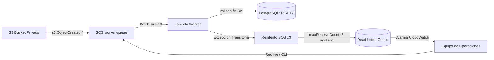

# Runbook: Monitorización, Diagnóstico y Replay de SQS Dead Letter Queue (DLQ)

> **Identificador:** RB-SQS-001  
> **Componente:** SQS Worker Queue & Lambda Worker (`apps/api/src/cdm/bootstrap/worker_handler.py`)  
> **Épica / Tarea:** CDM-6 / CDM-39  
> **Última actualización:** 2026-11-12  

---

## 1. Arquitectura y Flujo de Eventos

En Cloud Document Manager (CDM), el procesamiento de documentos se desacopla mediante eventos asíncronos:



### Configuración de Resiliencia (IaC Terraform)
- **Cola Principal:** `cdm-${environment}-document-events-queue`
- **Dead Letter Queue (DLQ):** `cdm-${environment}-document-events-dlq`
- **Política de Redrive (`maxReceiveCount`):** `3`
- **Visibility Timeout:** `300` segundos (5x la duración típica de la Lambda)
- **Retención en DLQ:** `14` días (1.209.600 segundos)

---

## 2. Monitorización y Alarmas de CloudWatch

### Alarma Automática
Se encuentra aprovisionada mediante el módulo `sqs-worker-queue`:
- **Nombre:** `${dlq_name}-messages-visible`
- **Métrica:** `AWS/SQS` / `ApproximateNumberOfMessagesVisible`
- **Condición:** `>= 1` durante 1 período de 300 segundos.
- **Severidad:** Media / Alta (indica que al menos un mensaje falló repetidamente y no pudo procesarse).

### Comandos de Inspección Rápida (AWS CLI)
```bash
# 1. Verificar número de mensajes en la DLQ
aws sqs get-queue-attributes \
  --queue-url "https://sqs.us-east-1.amazonaws.com/<account-id>/cdm-dev-document-events-dlq" \
  --attribute-names ApproximateNumberOfMessages ApproximateNumberOfMessagesNotVisible

# 2. Leer un mensaje de muestra de la DLQ sin eliminarlo (VisibilityTimeout corto para inspección)
aws sqs receive-message \
  --queue-url "https://sqs.us-east-1.amazonaws.com/<account-id>/cdm-dev-document-events-dlq" \
  --max-number-of-messages 1 \
  --visibility-timeout 30 \
  --attribute-names All \
  --message-attribute-names All
```

---

## 3. Diagnóstico: Clasificación del Fallo

Antes de ejecutar un redrive (replay) a la cola principal, es imperativo diagnosticar la naturaleza del fallo:

| Tipo de Fallo | Causa Raíz Típica | Comportamiento del Sistema | Acción Requerida |
|---|---|---|---|
| **Transitorio** | Interrupción temporal de base de datos RDS, throttling de CloudWatch, timeout de red o cold start extremo. | El mensaje falló 3 veces y fue enrutado a la DLQ. El documento en DB puede permanecer en `PROCESSING` o `UPLOADED`. | **Ejecutar SQS Redrive** tras restaurar la conectividad del servicio afectado. |
| **Definitivo (Validación Técnica)** | Archivo corrupto, tamaño 0 bytes, MIME spoofing o binario ejecutable (`.exe`, ELF). | El worker detecta la violación en memoria, marca el documento como `FAILED` con razón sanitizada y **NO** envía el mensaje a la DLQ (se descarta limpiamente). | El usuario/admin puede corregir o eliminar el documento en la UI. No llega a DLQ. |
| **Mensaje Envenenado (Poison Message)** | JSON malformado no parseable como evento S3, o evento de otro bucket ajeno no configurado. | Falla de parseo antes del caso de uso. | Inspeccionar el payload, registrar causa en CloudWatch Logs y purgar el mensaje si es espurio. |

---

## 4. Procedimiento de Reprocesamiento (Replay / Redrive)

### Opción A: SQS Redrive Masivo vía AWS CLI (Replay oficial de DLQ)
AWS SQS proporciona la API nativa `start-message-move-task` para redirigir mensajes desde la DLQ de regreso a la cola de origen de forma controlada y sin pérdida de mensajes:

```bash
# Iniciar tarea de redrive
aws sqs start-message-move-task \
  --source-arn "arn:aws:sqs:us-east-1:<account-id>:cdm-dev-document-events-dlq" \
  --destination-arn "arn:aws:sqs:us-east-1:<account-id>:cdm-dev-document-events-queue"

# Consultar el estado de la tarea de movimiento
aws sqs list-message-move-tasks \
  --source-arn "arn:aws:sqs:us-east-1:<account-id>:cdm-dev-document-events-dlq"
```

### Opción B: SQS Redrive desde la Consola de AWS
1. Abrir la consola de **Amazon SQS**.
2. Seleccionar la cola `cdm-<env>-document-events-dlq`.
3. Hacer clic en **"Start DLQ redrive"** en la barra superior.
4. Seleccionar la opción *"Redrive to the source queue"* (`cdm-<env>-document-events-queue`).
5. Definir la velocidad de redrive y hacer clic en **"Start redrive"**.
6. Observar en CloudWatch Logs del Lambda Worker (`/aws/lambda/cdm-<env>-document-worker`) que los lotes se procesen correctamente.

---

## 5. Reintento Manual Selectivo por API (CDM-39)

Cuando un documento específico se encuentra en estado `FAILED` (por ejemplo, tras un timeout durante la validación inicial) y un administrador desea reprocesarlo de forma puntual sin mover toda la DLQ:

### Endpoint
`POST /api/v1/workspaces/{workspace_id}/documents/{document_id}/retry`

### Reglas de Autorización y Límites
- **Rol Mínimo:** `ADMIN` u `OWNER` del workspace activo. (`MEMBER` o `VIEWER` reciben `403 Forbidden`).
- **Aislamiento Multi-Tenant:** Si el documento pertenece a otro tenant, se responde `404 Not Found` (anti-IDOR).
- **Límite Máximo de Reintentos:** Acotado estrictamente a `MAX_DOCUMENT_RETRIES = 3`. Superado este umbral, el endpoint responde `409 Conflict` (`max_retries_exceeded`) para prevenir costes imprevistos o loops infinitos.
- **Reinicio Consistente:** Transiciona el documento de `FAILED` a `PROCESSING`, incrementa `retry_count`, registra `last_retry_at` y limpia `failure_reason`.

---

## 6. Garantías de Idempotencia

El worker (`ProcessDocumentEventUseCase`) y las entidades de dominio implementan las siguientes invariantes:

1. **Documentos en `READY`:** Si un mensaje duplicado o reprocesado llega para un documento que ya completó su validación (`READY`), la operación es **estrictamente no-op** (`ProcessingStatus.ALREADY_PROCESSED`). No se reescriben metadatos ni se recalculan hashes.
2. **Documentos en `DELETED`:** Si un documento fue eliminado lógicamente antes del replay, el worker ignora el evento de forma segura.
3. **Control de Concurrencia:** Las transiciones de ciclo de vida impiden retrocesos inválidos (`_FORBIDDEN_BACKWARD_TRANSITIONS`).
